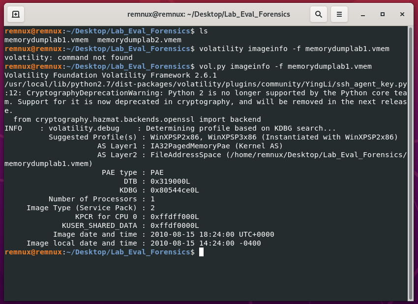
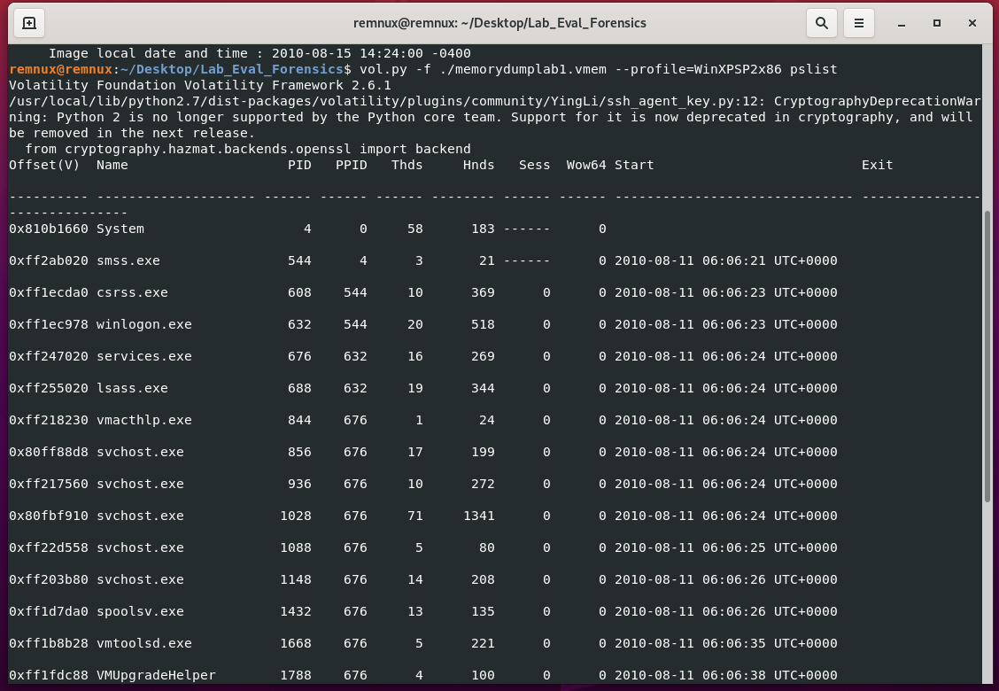
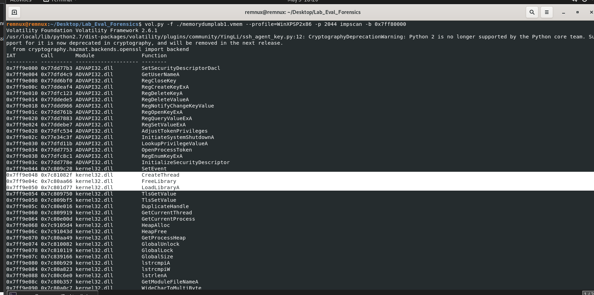
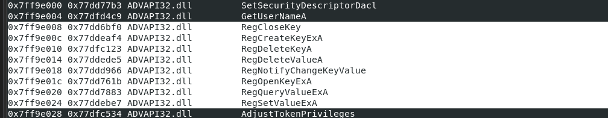
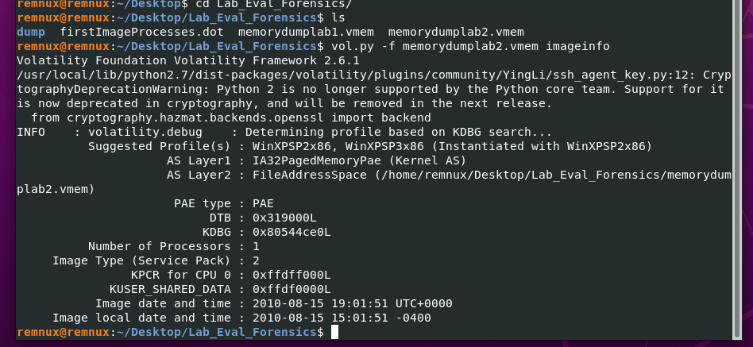
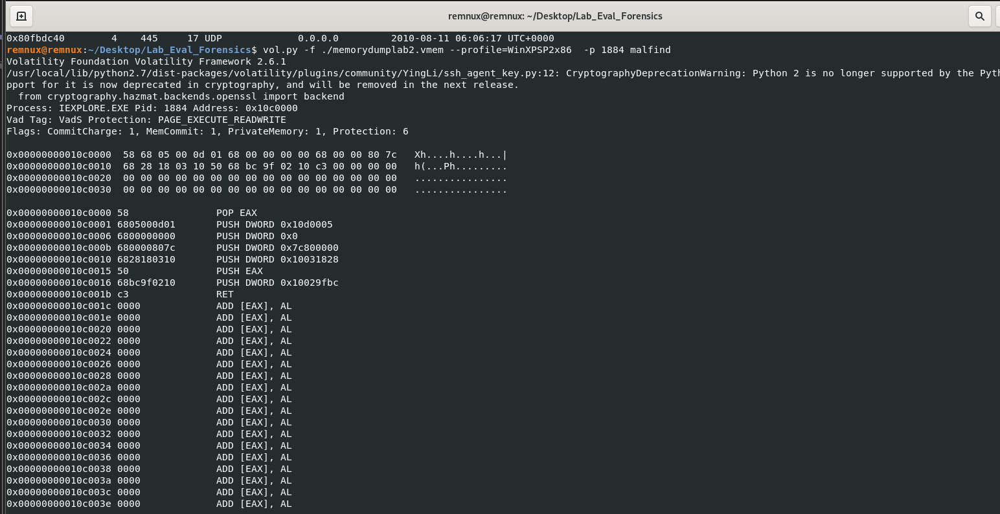
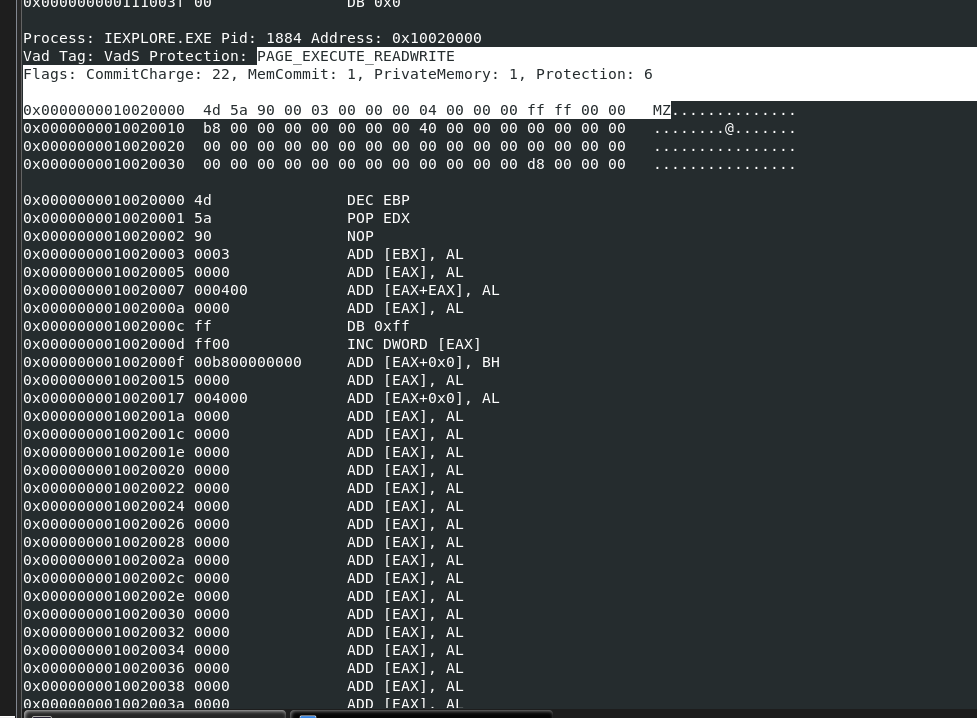
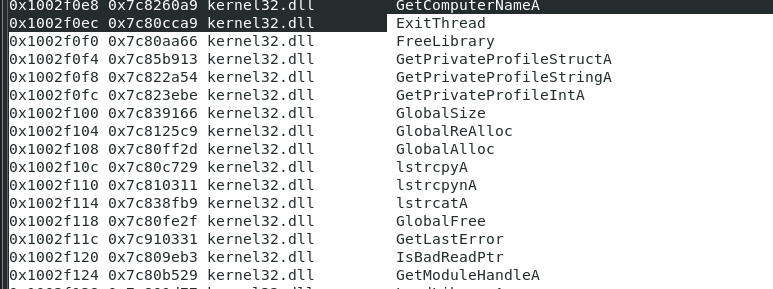
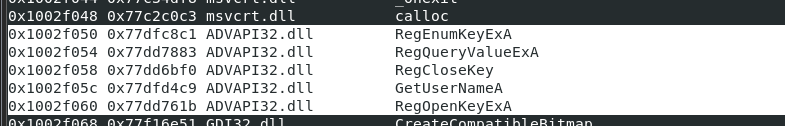

## Overview

Plenty of malware never shows up as a suspicious `evil.exe` in the process list. **Code injection** lets it hide inside a process that is supposed to be there. The malware allocates memory in a trusted target such as a browser, writes its code into that memory, and starts it running. Then it usually **hooks** functions in the target so that the browser's own traffic passes through it. On disk there may be nothing to find. In RAM, the injected code has to be present and executable, and that is the trace this workflow looks for.

This post is a reference guide to finding that trace with [Volatility 2](https://github.com/volatilityfoundation/volatility). I explain what each plugin tells you and why a particular result is suspicious. Then I apply the workflow to two Windows XP memory images, each infected with a different banking trojan injected into `IEXPLORE.EXE`:

1. **Coreflood**: an injected module that hooks `kernel32!GetProcAddress` in Internet Explorer's import table and talks to the outside world over HTTP. Its code sits at base address `0x7ff80000`.
2. **SilentBanker**: a full PE image at `0x10020000` that hooks Internet Explorer's networking and cryptography functions to steal credentials, private key certificates, and cookies.

If you are new to Volatility, the profile and basic plugin syntax are covered in my earlier post, [Memory Forensics with Volatility](). Here I focus on the malware-hunting plugins.

> **Scope and ethics.** Both memory images (`memorydumplab1.vmem` and `memorydumplab2.vmem`) were lab images provided for a forensics course evaluation. I did all the analysis offline in a [REMnux](https://remnux.org/) VM. No live systems were involved. One note for real incidents: I submitted the dumped process memory to VirusTotal below. That was fine for public lab samples, but process memory from a real machine can hold passwords, session cookies, and personal data. In a real case, submit hashes or the carved malicious region instead, never the whole dump.

## What injected code looks like in memory

To spot injected code, you need to know what *legitimate* code in a process looks like.

Windows tracks every allocation in a process's address space with a **Virtual Address Descriptor (VAD)**. VADs form a tree, and each node records the address range, the protection, and whether the range is backed by a file. Legitimate executable code nearly always comes from the loader: when `LoadLibrary` maps a DLL, its VAD is **image-backed**. It points at a section object for the DLL file on disk, and the module appears in the process's loaded-module lists. Heaps and stacks are **private** memory, but they are readable and writable, not executable.

A classic injection does something different:

1. `VirtualAllocEx` with `PAGE_EXECUTE_READWRITE` in the target process creates a **private** VAD (Volatility labels it `VadS`) that is writable *and* executable.
2. `WriteProcessMemory` copies shellcode, or an entire DLL, into that region.
3. `CreateRemoteThread` (or a hijacked thread) starts the code running.

The loader never sees this code. It has no file behind it and no entry in the module lists, yet its memory is executable. That combination is the signature to look for:

- **Private + executable** is unusual on its own. Ordinary programs have little reason to allocate memory they can both write to and run.
- **Private + RWX + an `MZ` header** is stronger still. `MZ` (`4D 5A`) is the start of a PE file. A PE image in memory the loader didn't map means someone loaded it by hand, which is what reflective DLL injection does.
- The main **false positive** is JIT compilers (.NET, Java, JavaScript engines, Flash). They legitimately generate code into private RWX memory, and they are common inside browsers. That is why a malfind hit is the start of an investigation, not the end of one.

Hooks are the second trace. Once the code is in place, the malware redirects existing functions to it. It does this either by overwriting a pointer in a module's **Import Address Table (IAT)** or by patching the first bytes of a function with a `JMP` (an **inline** or **trampoline** hook). When a hook's destination is in memory that belongs to no known module, you have found the injected code from the other direction.

## The workflow at a glance

| Step | Plugin | Question it answers |
|---|---|---|
| 1 | `imageinfo` | Which OS build is this, and which profile should I use? |
| 2 | `pslist`, `pstree` | What does the kernel's active process list say is running, and who started what? |
| 3 | `psscan`, `psxview` | Are there processes the active list doesn't show, either hidden or already exited? |
| 4 | `yarascan` | Do any known malware byte patterns appear in process memory? |
| 5 | `malfind` | Which processes have private, executable memory that looks like injected code? |
| 6 | `apihooks` | Which functions have been redirected, and to where? |
| 7 | `impscan` | What does the injected code import, and what does that say about its capabilities? |
| 8 | `connscan` | Which processes were talking to the network? |

All commands below use the same shape. Both images are Windows XP SP2 32-bit, analysed with Volatility 2.6.1. (The `CryptographyDeprecationWarning` at the top of every screenshot is a harmless Python 2 warning from a community plugin.)

## Case 1: Coreflood (memorydumplab1.vmem)

### Establishing the profile

```bash
vol.py -f memorydumplab1.vmem imageinfo
```



`imageinfo` locates the kernel debugger data block (KDBG at `0x80544ce0`) and suggests `WinXPSP2x86` and `WinXPSP3x86`. It instantiated `WinXPSP2x86`, and the reported service pack is 2, so that is the profile for everything that follows. Note the capture time, **2010-08-15 18:24:00 UTC**. Process start times are only meaningful relative to it.

### Enumerating processes

```bash
vol.py -f memorydumplab1.vmem --profile=WinXPSP2x86 pslist
vol.py -f memorydumplab1.vmem --profile=WinXPSP2x86 pstree
```

`pslist` walks the kernel's doubly linked list of active `EPROCESS` structures, the same list Task Manager reads.



 starts on 2010-08-15, four days after boot, and cmd.exe has already exited.")

Almost everything started at boot on 2010-08-11. Three entries are recent:

- **`IEXPLORE.EXE` (PID 2044)**, started 18:11:17 on 2010-08-15, about 13 minutes before capture, with 10 threads and 366 handles.
- **`logon.scr` (PID 124)**, the screensaver, started by `winlogon.exe` at 18:21:28.
- **`cmd.exe` (PID 1136)**, child of `vmtoolsd.exe`, with zero threads and an exit time equal to the capture time. This is VMware Tools running a command at snapshot time, which is expected in a lab VM.

`pstree` shows the same data as a hierarchy:

, whose own parent PID 1708 no longer exists.")

`IEXPLORE.EXE` is a child of `explorer.exe`, which is the normal parent for a browser the user launched from the desktop. `explorer.exe` itself appears as a root because its parent (PID 1708, normally `userinit.exe`) exits after logon. So far nothing looks wrong. That is exactly the problem with injection: the process tree looks fine.

### Cross-checking process views

`pslist` trusts a linked list that rootkits can unlink themselves from. `psscan` ignores that list and scans physical memory for `EPROCESS` pool allocations, so it also finds processes that are unlinked or already terminated. Rendering it as a graph makes the differences easy to see:

```bash
vol.py -f memorydumplab1.vmem --profile=WinXPSP2x86 psscan --output=dot --output-file=firstImageProcesses.dot
xdot firstImageProcesses.dot
```

 under winlogon.exe, shaded as exited at 2010-08-11 06:09:35.")

The graph shows one process `pslist` never listed: **`logonui.exe` (PID 1168)**, a child of `winlogon.exe`. `psxview` puts it in context by checking each process against seven independent sources:

```bash
vol.py -f memorydumplab1.vmem --profile=WinXPSP2x86 psxview
```

 is False in pslist and True in psscan, but it also has an exit time.")

Reading psxview correctly matters more than running it:

- A **hidden** process is one that is `False` in `pslist` but still `True` in sources a rootkit can't easily scrub, such as `thrdproc` (found through its threads) or `pspcid` (the kernel's handle table). It also has **no exit time**, because it is still running.
- `logonui.exe` is `False` everywhere except `psscan`, and it has an **ExitTime of 2010-08-11 06:09:35**. That is the pattern of a **terminated** process whose `EPROCESS` lingers in freed pool memory. `logonui.exe` draws the logon screen and exits once a user logs in, and three minutes after boot is a normal time for that.
- `False` entries for `System`, `smss.exe`, and `csrss.exe` in the `csrss`, `session`, and `deskthrd` columns are expected. Those processes start before the structures those columns rely on exist.

I still treated PID 1168 as a lead and dumped what remained of it (using its `psscan` physical offset). It came back clean, which fits a process that exited days before the capture. **No process in this image is hidden.** If something is wrong, it is inside a process that looks legitimate.

### Hunting with YARA

`yarascan` runs YARA rules over every process's memory. I used a community malware ruleset:

```bash
vol.py -f memorydumplab1.vmem --profile=WinXPSP2x86 yarascan -y ./Yara-Rules/malware_rules.yar
```

 at 0x7777cd01.")

The rule `Datper` matches inside `IEXPLORE.EXE` (PID 2044) at `0x7777cd01`. Datper is unrelated to Coreflood, and as we'll see in the second image, the same rule fires at the **same address** in a different Internet Explorer process. A hit at a fixed address in two images points to a shared module loaded at its usual base, and that is a common source of false positives with broad rulesets. A YARA hit is a reason to look more closely, not a verdict. It did put PID 2044 at the top of my list.

### Dumping and scanning the suspect

`memdump` writes out every addressable page of a process: its executable, every loaded DLL, heaps, and any injected regions.

```bash
vol.py -f memorydumplab1.vmem --profile=WinXPSP2x86 memdump -p 2044 -D MemDup-Processes/
vol.py -f memorydumplab1.vmem --profile=WinXPSP2x86 memdump -p 1168 --offset=0x066f1c08 -D MemDup-Processes/
```

![VirusTotal result for 2044.dmp (71.42 MB): 2 of 57 vendors flag it, Avast as Win32:Afcore [Trj] and Qihoo-360 as Trojan.Generic](08-coreflood-memdump-scan.png "VirusTotal on the IEXPLORE.EXE dump: 2/57 detections, including Avast's Win32:Afcore [Trj].")

Only 2 of 57 engines flag the 71 MB dump. That is typical: full process dumps are mostly legitimate Windows DLLs, and scanners aren't tuned for them. The useful part is the label. Avast calls it **`Win32:Afcore`**, and **AFCore** is another name for the **Coreflood** family. The `logonui.exe` remnant had no detections. From here on, PID 2044 is the focus, and the question is *where* in it the malware lives.

### Checking the network

```bash
vol.py -f memorydumplab1.vmem --profile=WinXPSP2x86 connscan
```

.")

`connscan` carves TCP connection objects out of memory, including connections that have already closed. Every one of the 26 connections it found belongs to PID 2044, and every one goes to port 80. A browser making HTTP connections is not suspicious in itself, so this doesn't prove anything alone. It does confirm that the suspect process was the only thing on this machine talking to the network, which fits public reporting that Coreflood uses HTTP for command and control.

### Confirming injection with malfind

`malfind` walks each process's VAD tree and reports private regions that are executable, along with a hexdump and disassembly of their first bytes:

```bash
vol.py -f memorydumplab1.vmem --profile=WinXPSP2x86 -p 2044 malfind
```

![malfind output for IEXPLORE.EXE PID 2044: Address 0x7ff80000, Vad Tag VadS, Protection PAGE_EXECUTE_READWRITE, Flags CommitCharge 45, PrivateMemory 1, Protection 6; the first 64 bytes are all zero and disassemble as ADD [EAX], AL](10-coreflood-malfind.png "malfind: a private (VadS) PAGE_EXECUTE_READWRITE region at 0x7ff80000 with 45 committed pages.")

This is the region I was looking for:

- **Address `0x7ff80000`**: a private VAD (`VadS`, `PrivateMemory: 1`) with **`PAGE_EXECUTE_READWRITE`** (`Protection: 6`) and 45 committed pages, about 180 KB.
- Internet Explorer has no reason to allocate 180 KB of writable, executable private memory. A legitimately loaded DLL would be image-backed, not `VadS`.
- The first 64 bytes are **zeros**, not an `MZ` header. That doesn't clear the region. Injected modules commonly wipe their PE header after loading so that header-based scans like the `MZ` check miss them. The real code starts further in, which the next two plugins confirm.

**Injected code base address: `0x7ff80000`.**

### Finding the hooks

`apihooks` checks every module in the process for IAT entries and function prologues that point outside the module they should point to. The output is long, so I saved it to a file:

```bash
vol.py -f memorydumplab1.vmem --profile=WinXPSP2x86 -p 2044 apihooks > firstImageApiHooks.txt
```


This ties the two findings together:

- **Hook type: IAT.** The import table of `iexplore.exe` itself (`0x400000`–`0x419000`) has been patched.
- **Function: `kernel32.dll!GetProcAddress`.** Every time Internet Explorer resolves a function by name at runtime, the call goes to the malware first. That is a powerful choke point. Whoever controls `GetProcAddress` can hand back their own replacement for any API the browser asks for.
- **Hook address: `0x7ff82360`**, just above the `0x7ff80000` base found by malfind, and **hooking module `<unknown>`**. Volatility couldn't attribute the destination to any loaded module, because the loader never mapped it.
- The disassembly at the hook is a decision routine: it calls `0x7ff81960`, tests the result, and either falls through or jumps through a pointer read from `0x7ffa5400`, which is also inside the injected region.

### Recovering the injected module's imports

Injected code still needs Windows APIs. If the malware loaded itself as a DLL, it built its own import table, and `impscan` can rebuild that table from a base address:

```bash
vol.py -f memorydumplab1.vmem --profile=WinXPSP2x86 -p 2044 impscan -b 0x7ff80000
```



The table sits at `0x7ff9e000`, inside the same region, so this is a full module with its own resolved import table, not a small shellcode blob. The imports outline its capabilities:

- **Loader and threading:** `LoadLibraryA`, `FreeLibrary`, and `CreateThread`, the minimum an injected module needs to pull in more DLLs and run its own threads inside the host.
- **Privilege manipulation:** `OpenProcessToken`, `LookupPrivilegeValueA`, and `AdjustTokenPrivileges`, followed by `InitiateSystemShutdownA`. Together these are the standard sequence for enabling a privilege (such as shutdown) and then using it.
- **Security descriptors:** `InitializeSecurityDescriptor` and `SetSecurityDescriptorDacl`, which are used to create objects with permissive access.
- **Host fingerprinting:** `GetUserNameA` and `GetModuleFileNameA`.



The registry imports are a complete set: create, open, query, set, delete, and `RegNotifyChangeKeyValue` to watch a key for changes. That set is consistent with storing configuration and persistence in the registry, and with defending those keys against removal. The next step would be registry analysis (`hivelist` and `printkey` on the Run keys) and `strings` on the carved region to recover configuration and C2 URLs.

### Coreflood: verdict

Internet Explorer (PID 2044) contains a module loaded by hand into private `PAGE_EXECUTE_READWRITE` memory at **`0x7ff80000`**, with the start of the region zeroed. It hooks `kernel32!GetProcAddress` in IE's import table, imports a full registry and privilege toolkit, and its host process made every HTTP connection in the image. Avast's `Afcore` label and that behaviour match published descriptions of the **Coreflood** trojan, which injects into Internet Explorer and uses HTTP to communicate with its servers.

## Case 2: SilentBanker (memorydumplab2.vmem)

The second image comes from the same VM about 38 minutes later. The core system processes have the same PIDs and offsets. That lets me move faster and concentrate on what changed.

### Profile and processes

```bash
vol.py -f memorydumplab2.vmem imageinfo
vol.py -f memorydumplab2.vmem --profile=WinXPSP2x86 psscan
```



, started about eight minutes before capture, and a wuauclt.exe (PID 1732) that has exited.")

The profile is again `WinXPSP2x86`. `psscan` shows a fresh **`IEXPLORE.EXE` (PID 1884)**, again a child of `explorer.exe` (PID 1724), created at 18:54:05. It also shows a second **`wuauclt.exe` (PID 1732)** alongside the long-running PID 468, with an exit time of 18:58:53.

```bash
vol.py -f memorydumplab2.vmem --profile=WinXPSP2x86 psxview
```

 shows the exited-process pattern, not the hidden-process pattern.")

`wuauclt.exe` is the Windows Update client. PID 1732 shows the same pattern as `logonui.exe` in the first image: present only in `psscan`, with an exit time. It is a finished update check, not a rootkit. Again, nothing is hidden.

### YARA: three hits, one real lead

```bash
vol.py -f memorydumplab2.vmem --profile=WinXPSP2x86 yarascan -y ./Yara-Rules/malware_rules.yar
```

 on what looks like registry data.")

 at 0x41002a07.")

 at 0x7777cd01, the same address and bytes as in the first image.")

Three processes matched, so I had to triage them:

- **`winlogon.exe` (PID 632), `SharedStrings`:** the matched bytes are UTF-16 path and registry strings, the kind of data winlogon always holds. It is a legitimate system process, and nothing else about it is anomalous.
- **`TPAutoConnSvc.e` (PID 1968), `QuarianCode`:** this is the ThinPrint AutoConnect service that VMware Tools installs, and it was running since boot in both images. The match is generic x86 code.
- **`IEXPLORE.EXE` (PID 1884), `Datper`:** the same rule, address, and bytes as in the Coreflood image. On its own this is weak evidence, but Internet Explorer is again the only candidate that is a user-launched, network-facing process started minutes before capture.

That leaves `IEXPLORE.EXE`.

```bash
vol.py -f memorydumplab2.vmem --profile=WinXPSP2x86 memdump -p 1884 -D MemDup-Processes/
```

 to 1884.dmp.")

![VirusTotal result for 1884.dmp (72.56 MB): 1 of 54 vendors, Avast, flags it as Win32:Agent-WRF [Trj]](21-silentbanker-memdump-2.png "VirusTotal on the dump: 1/54, with Avast reporting a generic Win32:Agent-WRF [Trj].")

One detection with a generic `Agent` label. That is enough to confirm something is wrong, but not enough to name it. Memory analysis has to do the rest.

### Network

```bash
vol.py -f memorydumplab2.vmem --profile=WinXPSP2x86 connscan
```

, all on remote port 80.")

Same picture as before: a run of HTTP connections, all owned by the suspect Internet Explorer process. Many of the remote addresses also appear in the first image's connection list, which suggests the same browsing session in both captures. This is why connection data supports a finding but rarely proves one.

### malfind: a stub and a full PE

```bash
vol.py -f memorydumplab2.vmem --profile=WinXPSP2x86 -p 1884 malfind
```



The first region is a single private RWX page at `0x10c0000`, and its code is short enough to read in full:

```text
POP  EAX              ; take the caller's return address
PUSH 0x10d0005        ; context value for this stub
PUSH 0x0
PUSH 0x7c800000       ; kernel32.dll base on XP
PUSH 0x10031828       ; address inside the module below
PUSH EAX              ; put the return address back
PUSH 0x10029fbc       ; address inside the module below
RET                   ; "return" to 0x10029fbc, i.e. jump there
```

This is a **hook trampoline**. A hooked function jumps here, and the stub forwards execution into the main module with a few context arguments. The `PUSH`/`RET` pair is a jump that avoids a literal `JMP` instruction. Both pushed code addresses point just above `0x10020000`, which leads to the second hit:



This is the textbook case:

- **Private** (`VadS`, `PrivateMemory: 1`) and **`PAGE_EXECUTE_READWRITE`**, with 22 committed pages.
- It starts with **`4D 5A 90 00 03 00 ...`**, the standard DOS header of a PE file (`MZ`), and the `e_lfanew` field at offset `0x3C` points to a PE header at `0xD8`.
- A PE image in private memory, with no file behind it and no entry in the module lists, can only get there by being copied in and loaded by hand.

malfind disassembles the header as if it were code (`DEC EBP`, `POP EDX`, ...). That disassembly is meaningless. What matters is the `MZ` in the ASCII column.

**Injected module base address: `0x10020000`.**

### apihooks: hooking cryptography

```bash
vol.py -f memorydumplab2.vmem --profile=WinXPSP2x86 -p 1884 apihooks > SecondImageAPIHooks.txt
```


Unlike Coreflood's IAT hook, SilentBanker uses **inline (trampoline) hooks**. The output contained many hooks, all with hooking module `<unknown>`. The one shown is typical:

- **Function `ADVAPI32.dll!CryptGenKey`**: its first bytes at `0x77e114b1` have been overwritten with **`JMP 0xef0000`**.
- **Hook address `0xef0000`**: the code there (`POP EAX; PUSH 0xf00005; PUSH 0; PUSH 0x7c800000; ...`) has exactly the same shape as the stub malfind found at `0x10c0000`. Each hooked function gets its own small stub, and every stub forwards into the module at `0x10020000`.

The choice of function is telling. `CryptGenKey` is the CryptoAPI call that generates keys, so hooking it gives the trojan visibility into the browser's key material. Combined with hooks on networking functions, code running inside the browser sees traffic **before encryption and after decryption**, so HTTPS gives the victim no protection against a trojan in their own browser.

### impscan: what the module can do

```bash
vol.py -f memorydumplab2.vmem --profile=WinXPSP2x86 -p 1884 impscan -b 0x10020000
```






The import table sits at `0x1002f000`, inside the injected image. It confirms a complete DLL (`__dllonexit` and `_onexit` come from the Microsoft C runtime's DLL startup code) and sketches its behaviour:

- **Fingerprinting the victim:** `GetComputerNameA` and `GetUserNameA`.
- **Reading configuration:** `RegOpenKeyExA`, `RegEnumKeyExA`, and `RegQueryValueExA`, plus the `GetPrivateProfile*` family for INI files. The visible registry imports only *read* and enumerate keys, which fits harvesting stored settings and credentials.
- **Staging stolen data:** `fopen`, `fprintf`, and `fclose`, which can be used to write captured data to a local file before exfiltration.
- **Screen capture:** `CreateCompatibleBitmap` and `SelectObject` from GDI32 are the building blocks for grabbing screenshots, which banking trojans use to defeat on-screen keyboards.
- **String hunting:** `strstr`, the obvious tool for matching URLs and form fields against a list of target banks.

### Where to look next: the registry

With registry reads in the import table, the natural next step is the hives:

```bash
vol.py -f memorydumplab2.vmem --profile=WinXPSP2x86 hivelist
```


`hivelist` gives the virtual offset of every loaded hive. The interesting one here is **`Administrator\NTUSER.DAT`**, the interactive user's hive, where per-user persistence (such as the `Run` key) and browser settings live. From here, `printkey -o <offset> -K "Software\Microsoft\Windows\CurrentVersion\Run"` and `strings` over the carved `0x10020000` region are the next steps for recovering persistence and the trojan's target list.

### SilentBanker: verdict

Internet Explorer (PID 1884) contains a full PE image loaded by hand into private `PAGE_EXECUTE_READWRITE` memory at **`0x10020000`**. Per-function stubs in separate RWX pages (such as `0xef0000` and `0x10c0000`) forward hooked calls into it, and one hooked function is `ADVAPI32!CryptGenKey`. Its imports cover fingerprinting, configuration harvesting, local logging, and screen capture. This combination matches published analyses of **SilentBanker**, which hooks Internet Explorer's networking and encryption functions so it can steal login credentials, private key certificates, and cookies, even from HTTPS sessions.

## Comparing the two

| | Coreflood | SilentBanker |
|---|---|---|
| Host process | `IEXPLORE.EXE` (PID 2044) | `IEXPLORE.EXE` (PID 1884) |
| Injected base | `0x7ff80000` | `0x10020000` |
| malfind header | First 64 bytes zeroed | `MZ` intact |
| Hook style | IAT hook on `kernel32!GetProcAddress` | Inline hooks via per-function stubs, e.g. `ADVAPI32!CryptGenKey` |
| Notable imports | Registry write/delete/watch, token privileges, shutdown | Registry read, INI files, GDI bitmaps, file I/O |

## Takeaways

- **A clean process tree proves nothing.** In both images, `pslist`, `pstree`, and `psxview` found nothing hidden. The "hidden" candidates were terminated processes, recognisable by their exit times. Injection exists precisely to make the process list look normal.
- **Private + executable + no file behind it is the core signal.** Legitimate code arrives through the loader as image-backed memory. A `VadS` region with `PAGE_EXECUTE_READWRITE`, and especially one starting with `MZ`, means someone loaded code by hand. A zeroed header doesn't clear a region. Some malware wipes it on purpose.
- **Corroborate across plugins.** The strongest evidence came from addresses that agreed: the apihooks destination `0x7ff82360` and the impscan IAT `0x7ff9e000` both sit inside the malfind region at `0x7ff80000`, and SilentBanker's stub code pushes addresses inside its `0x10020000` module. One plugin's hit is a lead. Three plugins pointing at the same address range is a finding.
- **Treat signature hits as leads.** Both YARA and VirusTotal flagged the right process, but with an unrelated rule name and one or two generic detections. Behaviour recovered from memory (hooks and imports) is what identifies the family.
- **Hooks show intent.** Hooking `GetProcAddress` gives control over every API Internet Explorer resolves. Hooking `CryptGenKey` and the networking layer puts the trojan on the plaintext side of SSL. Which functions a trojan hooks tells you what it is after.

*Tools: Volatility 2.6.1 on REMnux, xdot, YARA community rules, VirusTotal. Images: `memorydumplab1.vmem` (Coreflood) and `memorydumplab2.vmem` (SilentBanker), Windows XP SP2 x86.*
