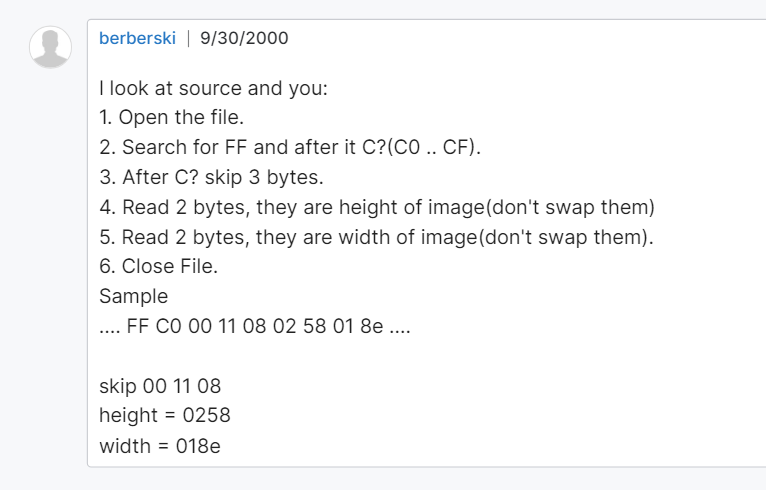
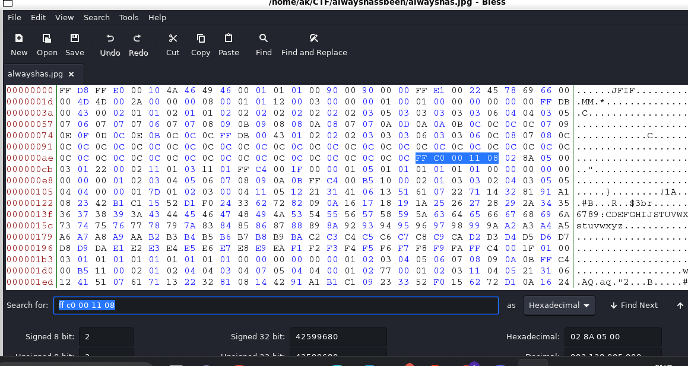
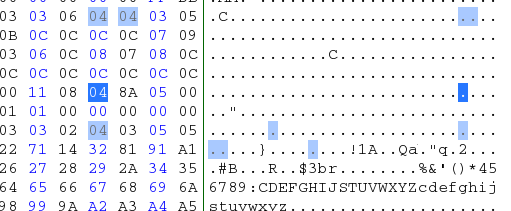
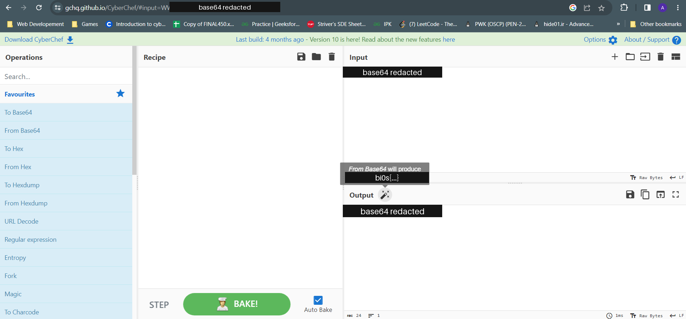

## Overview

When an image is suspected of carrying hidden data, there are three broad places to look:

1. **The header.** The file format records how the picture should be decoded, including its width and height. Change those numbers, and a viewer will happily display a different picture from the same bytes.
2. **The metadata.** JPEG and PNG both have room for text that never gets drawn: comments, EXIF tags, XMP, and so on. Anything can be stored there.
3. **The pixels.** Data can be hidden in small changes to colour values that the eye can't see, but that become obvious once you pull the image apart one bit at a time.

These are independent techniques, and in a real investigation I check all three. This post is a reference guide to each one, using three forensics challenges from the **DD CTF** run by team [bi0s](https://bi0s.in/) as worked examples:

| Challenge | Where the data was hidden | Technique |
|---|---|---|
| **always has been** | Rows cropped out by a shrunken height field | Edit the JPEG SOF0 marker in a hex editor |
| **project meta** | A base64 string in the JPEG comment | `exiftool`, then base64 decoding |
| **blindfold** | Pixel values only visible in individual bit planes | Bit-plane analysis with [Aperi'Solve](https://www.aperisolve.com/) |

If you've read my post on [repairing corrupted PNG files](/posts/repairing-corrupted-png-files/), the first technique will feel familiar, but JPEG has one important difference: it has no checksum to tell you something was changed.

> **Scope and ethics.** These were educational challenge files from a CTF that has since concluded. Everything here was done on local copies of files the organisers distributed for that purpose. Flags are redacted as `bi0s{...}` in the text and blacked out in the screenshots.

## Technique 1: hidden dimensions in the JPEG SOF0 marker

### How a JPEG stores its size

A JPEG file is a sequence of **segments**, and each one starts with a two-byte marker: `FF` followed by a type byte. Most segments then give a two-byte big-endian length, which counts the length field itself plus the payload but not the marker. A typical baseline file looks like this:

| Marker | Name | Purpose |
|---|---|---|
| `FF D8` | SOI | Start of image (no length field) |
| `FF E0` | APP0 | JFIF header |
| `FF E1` | APP1 | EXIF metadata (optional) |
| `FF DB` | DQT | Quantisation tables |
| `FF C0` | SOF0 | **Start of frame: precision, height, width, components** |
| `FF C4` | DHT | Huffman tables |
| `FF DA` | SOS | Start of scan, followed by the compressed image data |
| `FF D9` | EOI | End of image |

The dimensions live in the **Start of Frame** segment. For a baseline JPEG that's SOF0, marker `FF C0`. Its layout is:

```text
FF C0  00 11  08  02 8A  05 00  03  01 22 00  02 11 01  03 11 01
marker length P   height width  N   comp 1    comp 2    comp 3
```

| Offset | Size | Field | Value above |
|---|---|---|---|
| 0 | 2 bytes | Marker | `FF C0` (SOF0, baseline DCT) |
| 2 | 2 bytes | Segment length | `00 11` = 17 bytes |
| 4 | 1 byte | Sample precision | `08` = 8 bits per sample |
| 5 | 2 bytes, big-endian | **Height** (number of lines) | `02 8A` = 650 |
| 7 | 2 bytes, big-endian | **Width** (samples per line) | `05 00` = 1280 |
| 9 | 1 byte | Number of components | `03` (Y, Cb, Cr) |
| 10 | 3 bytes each | Component ID, sampling factors, quantisation table | `01 22 00`, `02 11 01`, `03 11 01` |

The length checks out: 2 (length) + 1 (precision) + 2 (height) + 2 (width) + 1 (count) + 3 × 3 (components) = 17. Two details are easy to get wrong:

- **Height comes before width.** This is the opposite of PNG's IHDR chunk, which stores width first.
- **Other SOF types use the same layout.** Progressive JPEGs use SOF2 (`FF C2`), and there are several rarer variants. The full set is `C0`–`C3`, `C5`–`C7`, `C9`–`CB`, and `CD`–`CF`. The gaps matter: `FF C4` is a Huffman table (DHT), not a frame header, so a naive "search for `FF C?`" will land on the wrong segment.

### Why shrinking the height hides content

The compressed image data after SOS is a stream of 8×8 (or 16×16) pixel blocks, encoded left to right and top to bottom. Nothing in that stream says how many rows there are. The decoder takes that number from SOF0, decodes enough block rows to fill it, and ignores whatever is left.

That has three consequences:

- **Reduce the stored height, and the bottom of the picture is silently cropped.** The pixel data is still in the file, it just never gets drawn.
- **Nothing complains.** JPEG has no checksum over its headers, unlike PNG's per-chunk CRC. The file is perfectly valid at the smaller size, and tools like `exiftool` simply report whatever SOF0 says.
- **Increase the height, and the hidden rows come back.** If you overshoot, the decoder runs out of data, warns about it (libjpeg prints `Corrupt JPEG data: premature end of data segment`), and fills the remaining rows with flat grey.

The width is a different matter. Changing it changes how many blocks make up each row, so every row after the first starts at the wrong place in the stream and the picture shears into diagonal garbage. In practice, the hiding trick is almost always done on the height.

### Worked example: always has been

The challenge description talked about investigators noticing "subtle inconsistencies in the dimension of the image", and the file was a landscape photo named `alwayshas.jpg`. Resizing it with an online tool didn't help, which makes sense: a resizer only scales the pixels the decoder already produced. It can't bring back rows the decoder never drew. The fix has to happen in the header.

The standard description of where JPEG dimensions are stored pointed me at the SOFn marker:

 marker.")

One answer on that thread gives a compact recipe: find `FF` followed by a SOF type, skip three bytes (length and precision), then read two bytes of height and two bytes of width:



In its sample, `FF C0 00 11 08 02 58 01 8E` decodes to a height of `0x0258` (600) and a width of `0x018E` (398). (As noted above, the "C0 to CF" range in that answer is slightly too broad, because it includes `C4`, `C8`, and `CC`, which aren't frame headers.)

I opened the file in Bless and searched for `FF C0 00 11 08`, the SOF0 marker plus its usual 17-byte length and 8-bit precision:



The dump is a nice illustration of the segment layout from earlier. The file opens with `FF D8 FF E0 00 10 4A 46 49 46` (SOI, then the JFIF APP0 segment), followed by an `FF E1` EXIF segment, `FF DB` quantisation tables, and then SOF0. Right after SOF0 you can see the three component entries (`03 01 22 00 02 11 01 03 11 01`) and then `FF C4`, the first Huffman table.

The four bytes after `FF C0 00 11 08` are:

- **Height:** `02 8A` = 650
- **Width:** `05 00` = 1280

1280 × 650 is an unusual shape for a photo. I left the width alone and raised the height's high byte from `02` to `04`, making it `04 8A`, or 1162 rows:



Opening the patched file shows the full picture, including the rows that the original height had cut off:

 appears at the bottom of the photo. The grey band below is where the scan data runs out.")

The flag sits just below where the original 650-row image ended. The grey area underneath is the overshoot: 1162 rows is more than the file contains, so the decoder filled the remainder with grey. Judging by the 75% zoom, the photo itself ends a little over 700 rows down, which suggests the original was a standard 1280×720 frame. To produce a clean copy, you would lower the height until the grey band disappears.

### Doing it from the command line

A hex editor is fine for a one-off, but searching for `FF C0` byte patterns can produce false positives. For example, a JPEG thumbnail embedded in the EXIF segment has its own SOF0 marker. The robust approach is to walk the segments by their length fields until you reach a frame header. This short script does that, prints the dimensions, and optionally rewrites the height:

```python
import struct, sys

SOF_MARKERS = {0xC0, 0xC1, 0xC2, 0xC3, 0xC5, 0xC6, 0xC7, 0xC9, 0xCA, 0xCB, 0xCD, 0xCE, 0xCF}

def find_sof(data):
    pos = 2                                   # skip FF D8 (SOI)
    while pos + 4 <= len(data):
        if data[pos] != 0xFF:
            raise ValueError(f"lost marker sync at 0x{pos:x}")
        marker = data[pos + 1]
        length = struct.unpack(">H", data[pos + 2:pos + 4])[0]
        if marker in SOF_MARKERS:
            return pos, marker
        if marker == 0xDA:                    # SOS: compressed data follows
            break
        pos += 2 + length
    raise ValueError("no SOF marker found")

path = sys.argv[1]
data = bytearray(open(path, "rb").read())
pos, marker = find_sof(data)
precision = data[pos + 4]
height, width = struct.unpack(">HH", data[pos + 5:pos + 9])
print(f"SOF{marker - 0xC0} at 0x{pos:x}: precision={precision} height={height} width={width}")

if len(sys.argv) == 3:
    data[pos + 5:pos + 7] = struct.pack(">H", int(sys.argv[2]))
    open(path, "wb").write(data)
    print(f"height set to {sys.argv[2]}")
```

```shell
cp image.jpg patched.jpg
python3 sof.py patched.jpg          # read the stored dimensions
python3 sof.py patched.jpg 2000     # overshoot the height, then inspect
```

I tested it on a 1280×720 JPEG of my own: setting the height to 650 cropped the bottom rows without any error, and setting it back to 720 restored them exactly. Always work on a copy, since the script edits the file in place.

## Technique 2: metadata and base64

### Where metadata hides

Image formats carry a surprising amount of text that is never rendered:

- **JPEG comment segment** (`FF FE`, "COM"): free-form text, shown by exiftool as `Comment`.
- **EXIF** (inside the `FF E1` APP1 segment): camera make and model, timestamps, GPS coordinates, and free-text fields like `ImageDescription`, `UserComment`, `Artist`, and `Copyright`.
- **XMP** and **IPTC**: XML and newsroom metadata, often added by editing software.
- **PNG text chunks** (`tEXt`, `zTXt`, `iTXt`): key-value text, optionally compressed.

[ExifTool](https://exiftool.org/) reads all of these, so it's the first thing I run on any image:

```shell
exiftool image.jpg
```

A few options make the output more useful for forensics:

```shell
exiftool -a -G1 -s image.jpg      # show duplicates, the group each tag came from, and short tag names
exiftool -Comment image.jpg       # print a single tag
exiftool -b -Comment image.jpg    # print the raw value with no label (good for piping)
```

The `-G1` group column matters because the dates exiftool prints under `System` (File Modification, Access, and Inode Change) come from the **local filesystem**, not from the image. They describe when the file landed on my disk, not when the photo was taken.

### Recognising base64

Base64 encodes every 3 bytes as 4 characters from the alphabet `A–Z a–z 0–9 + /`. The giveaways are:

- only those 64 characters, with no spaces,
- a length that's a multiple of 4, and
- one or two `=` padding characters at the end when the input length wasn't a multiple of 3.

A metadata field that looks like random letters and digits ending in `==` is almost certainly base64. Decoding it on the command line is one line:

```shell
echo '<base64-string>' | base64 -d
```

Or, straight from the metadata without copying anything by hand:

```shell
exiftool -b -Comment image.jpg | base64 -d
```

### Worked example: project meta

The challenge text leaned heavily on metadata ("hidden secrets nestled within the metadata fields... timestamps, geolocation coordinates, and authorship details"), so exiftool was the obvious first step:

.")

The output is short. There are no camera tags, no GPS coordinates, and no authoring software, despite what the description implied. The timestamps are all filesystem times from my own machine. What's left is a 1200×900 baseline JPEG with a JFIF header and one interesting field: a `Comment` whose value is a short alphanumeric string ending in `==`.

To confirm it was base64, I pasted it into [CyberChef](https://gchq.github.io/CyberChef/). Its "Magic" detector recognised the encoding immediately and offered a preview of the decoded value:



Applying the **From Base64** operation decodes it to the flag:

.")

The `exiftool -b -Comment image.jpg | base64 -d` one-liner above gets the same result without leaving the terminal.

## Technique 3: bit-plane analysis

### What a bit plane is

In an 8-bit RGB image, each pixel has three values from 0 to 255, one each for red, green, and blue. Each of those values is 8 bits, so you can split every channel into **8 black-and-white images**, one per bit position. That gives 24 bit planes in total:

- **The most significant planes (bit 7, bit 6)** carry the coarse structure. They look like a high-contrast version of the photo.
- **The least significant planes (bit 0, bit 1)** look like random noise in a natural photo, because sensor noise and compression dominate the low bits.

That split is exactly why bit planes are useful for steganography. Text drawn in a colour that differs from the background by only one or two levels is invisible in the normal image but appears as solid shapes in the low planes. Data written into the least significant bits (classic LSB steganography) breaks up the expected noise pattern in a way that's easy to spot.

### Worked example: blindfold

For "blindfold" I uploaded the image to [Aperi'Solve](https://www.aperisolve.com/), which runs a battery of analyses in one go. Alongside tools such as `zsteg`, `steghide`, `binwalk`, `exiftool`, and `strings`, it renders every bit plane of every channel as a grid of images. The flag was obvious in that grid:

 appears as a text banner across the top of each panel in the lower row.")

The upper row shows the noisy planes typical of low-order bits. In the lower row the picture's structure is clear, and each panel has the flag written in a text banner across the top. The bottom-right panel is the cleanest. My screenshot is cropped, so I can't say which channel and bit position each panel corresponds to, only that the text appears across several planes.

### Doing it locally

Aperi'Solve is convenient, but it means uploading the file to a third-party server. That's fine for a CTF file, but it's not something I would do with case evidence. The same bit-plane split takes a few lines of Python with Pillow and NumPy:

```python
import sys
import numpy as np
from PIL import Image

img = np.array(Image.open(sys.argv[1]).convert("RGB"))
for c, name in enumerate("RGB"):
    for bit in range(8):
        plane = ((img[:, :, c] >> bit) & 1) * 255
        Image.fromarray(plane.astype(np.uint8)).save(f"{name}{bit}.png")
```

```shell
python3 planes.py image.png     # writes R0.png ... B7.png
```

As a sanity check, I drew text on a test image in a red value just one level above the background. The text was invisible in the image itself, but it appeared as solid white in `R0.png` and was absent from every other plane. For a GUI, Stegsolve steps through the same planes interactively, and `zsteg` automates LSB extraction for PNG and BMP files.

## Takeaways

- **Check all three layers.** Header, metadata, and pixels are independent hiding places. A clean `exiftool` output says nothing about the pixel data, and vice versa.
- **Viewers trust the header.** A JPEG's SOF0 height and width decide what gets drawn, and nothing verifies them against the data. A shrunken height crops content silently. Raise it, and the hidden rows come back, with grey filling any overshoot.
- **Know the SOF0 layout.** `FF C0`, a 2-byte length, a 1-byte precision, then **height before width**, each 2 bytes big-endian. Walk segments by their lengths rather than searching for `FF C0` blindly.
- **Learn what base64 looks like.** A 64-character alphabet, a length that's a multiple of 4, and trailing `=` padding. In metadata, that's a strong sign someone put it there deliberately.
- **Bit planes expose small differences.** Content that differs from its surroundings by one or two colour levels is invisible to the eye but stands out in the matching plane. Run the analysis locally when the file is sensitive.

*Tools: Bless hex editor, ExifTool, CyberChef, Aperi'Solve, Python (Pillow, NumPy). Challenges: "always has been", "project meta", and "blindfold", DD CTF by team bi0s.*
