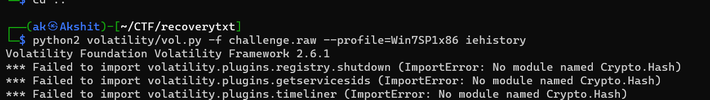
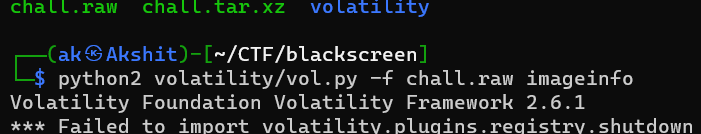
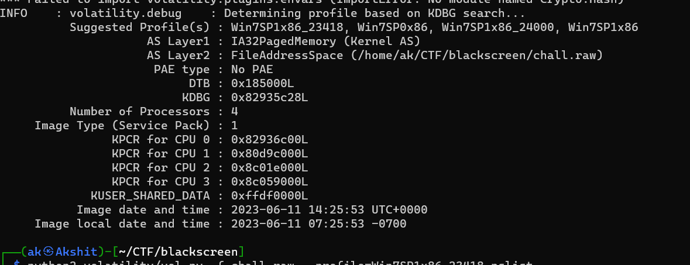
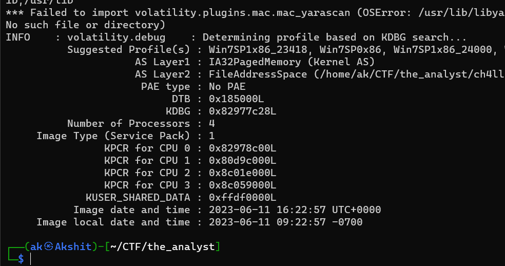
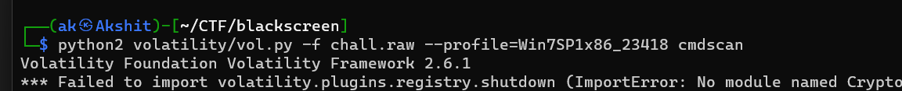
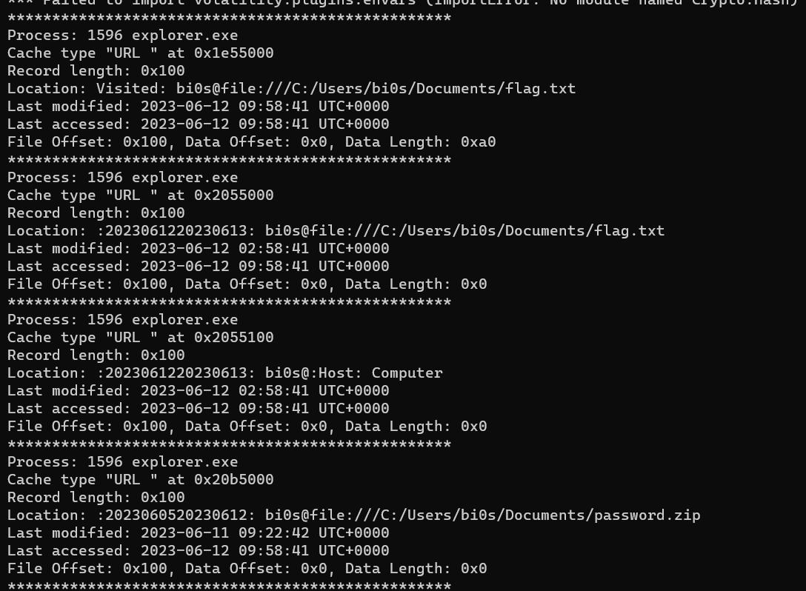
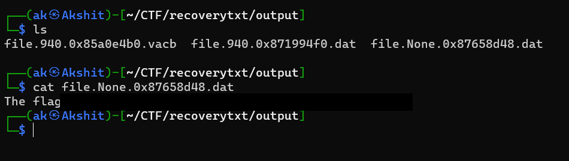
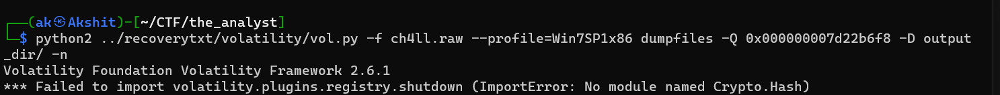
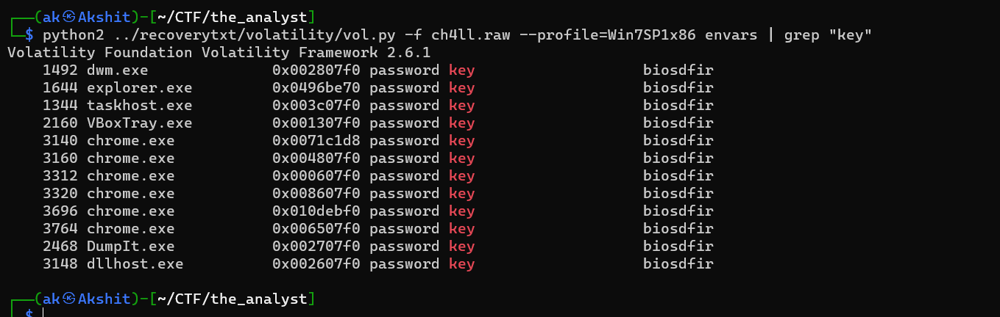
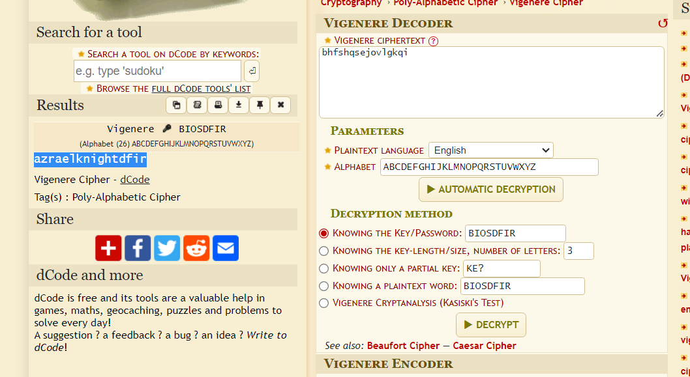

## Overview

A disk image tells you what was *stored* on a machine. A memory image tells you what the machine was *doing*: which processes were running, which files they had open, what someone typed into a console, which URLs a browser had loaded, and which secrets were sitting in environment variables. A lot of that never reaches the disk, so RAM is often the only place to find it.

[Volatility](https://github.com/volatilityfoundation/volatility) is the standard open-source framework for this work. It reads a raw memory image, rebuilds the operating system's kernel data structures, and gives you plugins that answer specific questions, such as "list the processes" or "show me the console history". This post is a reference guide to the workflow I follow on Windows memory dumps. I explain each plugin and what its output means, then work through three challenges from the **DD CTF** run by team [bi0s](https://bi0s.in/):

- **recoverytxt**: browser history points at two files, which I recover from memory and decode.
- **blackscreen execution**: the answer sits in console command history.
- **the analyst**: a password-protected zip recovered from memory, an environment variable holding a cipher key, and a Chrome process whose memory contains a pastebin link.

I don't cover the challenges one at a time. Each one appears at the step of the workflow where it gets solved.

> **Scope and ethics.** These were educational memory images from a CTF that has since concluded. All analysis was done locally on dumps the organisers distributed for that purpose. Flags are redacted as `bi0s{...}` in the text and blacked out in the screenshots.

## Volatility in brief

All three dumps are **Windows 7 SP1, 32-bit** images, and I analysed them with **Volatility 2.6.1**, which runs on Python 2. Volatility 2 has to be told which OS build produced the dump. It does this through a **profile**, a name like `WinXPSP2x86`, `Win7SP1x86`, or `Win7SP1x64` that bundles the structure layouts (offsets of fields inside `_EPROCESS`, `_FILE_OBJECT`, and so on) for that build. If the profile is wrong, plugins misread memory and return garbage or nothing at all. Volatility 3 drops profiles in favour of downloadable symbol tables, but the plugin concepts below carry over almost one-to-one.

Every command has the same shape:

```bash
python2 vol.py -f <image> --profile=<Profile> <plugin> [options]
```

### A note on import errors

When Volatility starts, you will probably see a wall of messages like this:



These errors mean the plugin modules that import `Crypto.Hash` could not be loaded. They are not just cosmetic. In my first runs, `envars` was one of the plugins that failed to load. The fix is to install a crypto library that provides the `Crypto` namespace for Python 2, for example:

```bash
pip2 install pycryptodome distorm3
```

A similar error about `libyara` only affects the YARA-scanning plugins and is safe to ignore if you don't need them.

## Step 1: identify the profile with imageinfo

**Always run `imageinfo` first.** Every other plugin depends on the profile, and `imageinfo` is how you find it.

```bash
python2 vol.py -f chall.raw imageinfo
```



`imageinfo` scans the image for the kernel debugger data block (**KDBG**), a structure Windows keeps for debuggers that points to the process list, the loaded-module list, and other key kernel structures. Its contents and location identify the OS build. Here is the output for the blackscreen image:



How to read it:

- **Suggested Profile(s)**: candidates in order of likelihood. `Win7SP1x86_23418` and `Win7SP1x86_24000` are profiles for specific Windows 7 SP1 kernel builds; `Win7SP1x86` is the generic SP1 profile. All of them point to 32-bit Windows 7.
- **AS Layer1: IA32PagedMemory** and **PAE type: No PAE**: Volatility will translate virtual addresses using 32-bit, non-PAE paging. This is the address space every plugin uses.
- **DTB**: the Directory Table Base, the physical address of the kernel's page directory (the value in the `CR3` register). Volatility needs it to translate kernel virtual addresses.
- **KDBG** and **KPCR for CPU 0-3**: the debugger block and one processor control region per CPU. Four KPCRs is consistent with "Number of Processors: 4".
- **Image Type (Service Pack): 1**: confirms SP1.
- **Image date and time**: when the dump was taken (2023-06-11 14:25:53 UTC, or 07:25:53 at UTC-7 local time). This anchors every other timestamp you will see.

For blackscreen I used the first suggestion, `Win7SP1x86_23418`. The other two images gave the same picture. Here is the one for "the analyst" (`ch4ll.raw`):



For that image and for recoverytxt, the generic `Win7SP1x86` profile worked fine. If two suggested profiles give conflicting results, the `kdbgscan` plugin shows each KDBG candidate in detail, including how many processes and modules it finds. The candidate with sensible non-zero counts is the right one.

## Step 2: map the processes

With the profile set, the next question is what was running. There are four process plugins, and the differences between them matter:

```bash
python2 vol.py -f ch4ll.raw --profile=Win7SP1x86 pslist
python2 vol.py -f ch4ll.raw --profile=Win7SP1x86 pstree
python2 vol.py -f ch4ll.raw --profile=Win7SP1x86 psscan
python2 vol.py -f ch4ll.raw --profile=Win7SP1x86 psxview
```

- **`pslist`** walks the kernel's doubly linked list of active `_EPROCESS` structures, which is the same list Task Manager uses. It is fast and accurate for normal processes, but it misses anything unlinked from the list, such as processes hidden by a rootkit or processes that have already exited.
- **`pstree`** shows the same data as `pslist` but indents each child under its parent. That makes odd parent-child relationships obvious, such as `cmd.exe` spawned by a document viewer.
- **`psscan`** ignores the list completely. It scans physical memory for the pool tag that marks `_EPROCESS` allocations, so it also finds terminated processes (with an exit time) and unlinked ones.
- **`psxview`** cross-checks several sources (the active list, pool scanning, the thread list, the CSRSS handle table, and others) and prints a True/False matrix. A process that shows False under `pslist` but True elsewhere has been hidden on purpose.

In "the analyst", one line of the `pslist` output stood out:

 is Chrome's crash handler, and VBoxTray.exe shows this was a VirtualBox guest.")

The columns are the virtual offset of the `_EPROCESS`, the name, PID, parent PID, thread and handle counts, session, a WoW64 flag, and the start time. Two details help with reading lists like this:

- Names are cut off at 14 characters (`GoogleCrashHan`, `SearchIndexer.`) because the `ImageFileName` field in `_EPROCESS` is a fixed 15-byte buffer. `GoogleCrashHan` is `GoogleCrashHandler.exe`, which Chrome installs. If you need the full path, the `dlllist` or `cmdline` plugins read it from the process environment block.
- `VBoxTray.exe` is the VirtualBox guest-additions tray process, so this dump came from a VM. Its parent, PID 1644, is `explorer.exe`, which is normal for a tray application.

A Chrome-related process becomes important later. I come back to PID 1196 in Step 6.

## Step 3: console history with cmdscan

On Windows 7, the console window for `cmd.exe` is hosted by `conhost.exe`. On XP and Server 2003 it is hosted by `csrss.exe`. The host process keeps a `_COMMAND_HISTORY` buffer of everything typed at the prompt, the same buffer you scroll through with the up arrow. `cmdscan` searches the host processes for those structures:

```bash
python2 vol.py -f chall.raw --profile=Win7SP1x86_23418 cmdscan
```

This was the first plugin I ran on **blackscreen execution**. A black screen strongly suggests a console window, and it turned out to be the whole challenge:



. The second history belongs to DumpIt.exe, the tool that captured this image.")

How to read each block:

- **CommandProcess / Application**: the host (`conhost.exe`, PID 3928) and the console application it served (`cmd.exe`).
- **CommandCount / CommandCountMax**: one command recorded, out of a default 50-entry buffer.
- **Cmd #0**: the recorded line. Someone typed `the flag is bi0s{...}` at the prompt. It isn't a valid command, but `conhost` records the line before `cmd.exe` tries to run it.
- **Cmd #36 and #37**: noise. `cmdscan` finds these structures by scanning rather than by following pointers, so slots past the real count can contain leftover bytes. Trust the entries up to `CommandCount`.

The second block is worth noticing in any real investigation. Its application is **DumpIt.exe**, a common memory-acquisition tool. You will often find the acquisition tool in its own dump, and seeing it confirms how and when the image was taken.

`cmdscan` only shows **input**. Its sibling `consoles` also reconstructs the console **screen buffer**, which shows command output as well. It is worth running both whenever a console was involved.

## Step 4: browser and file-access history with iehistory

`iehistory` parses the WinINet cache (`index.dat` records) in process memory. That covers Internet Explorer history, and also something more useful: **Windows Explorer records local file access through the same WinINet history**, as `file:///` URLs. That makes this plugin a quick way to see which files a user opened.

```bash
python2 vol.py -f challenge.raw --profile=Win7SP1x86 iehistory
```

In **recoverytxt**, after a first pass with the usual process plugins turned up nothing unusual, `iehistory` was the output that mattered:



Each record shows:

- **Process**: `explorer.exe`, not a browser. Explorer is the process that opened the local files.
- **Location**: `Visited: bi0s@file:///C:/Users/bi0s/Documents/flag.txt` is a record from the main history container. Entries prefixed `:2023061220230613:` come from a daily history container covering 12 to 13 June 2023, which is why the same file appears more than once.
- **Last modified / Last accessed**: the `password.zip` entry was last modified 2023-06-11 09:22:42 UTC, and both files were accessed 2023-06-12 09:58:41 UTC.

So there are two named targets: `flag.txt` and `password.zip`, both in the user's Documents folder. The next step is to get them out of memory.

Note that `iehistory` only understands WinINet. It does not see Chrome or Firefox history. In "the analyst" the challenge description hinted at internet history, and `iehistory` came back empty, which is why that trail led to Step 6 instead.

## Step 5: recover files with filescan and dumpfiles

### Finding file objects

Whenever Windows opens a file, the kernel creates a `_FILE_OBJECT`. `filescan` finds them by pool-tag scanning physical memory, so it also catches objects for files that have since been closed. The output is long, so always filter it:

```bash
python2 vol.py -f challenge.raw --profile=Win7SP1x86 filescan | grep -i "password.zip"
python2 vol.py -f challenge.raw --profile=Win7SP1x86 filescan | grep -i "flag"
```


The columns are the **physical offset** of the `_FILE_OBJECT`, pointer and handle counts, the access mask (`R--rwd` means opened for read, with read/write/delete sharing), and the device path. The physical offset in the first column is what the next plugin needs.

The first command in the screenshot fails with "The requested file doesn't exist". That is not a forensics result; it is Volatility failing to open the memory image because I ran it from the wrong directory and the relative path to `vol.py` and the image was off. After `cd` into the right folder, the same command returns the object.

### Dumping the contents

`dumpfiles` extracts the cached contents of a file object. The `-Q` option takes the physical offset from `filescan`:

```bash
python2 vol.py -f challenge.raw --profile=Win7SP1x86 \
  dumpfiles -Q 0x000000003e4472a0 --dump-dir ./output
```

A few things to know about `dumpfiles`:

- It recovers whatever pages of the file were resident in memory. If the file was fully cached, you get the whole thing; if not, you get the parts that were paged in.
- It writes files named after the object, such as `file.None.0x87658d48.dat` (a `DataSectionObject`) or `file.940.0x871994f0.vacb` (a view of the cache). The `.dat` copy is usually the one you want.
- You give it the offset, not the filename, so it is easy to lose track of which output came from which object. When I dumped several at once I had to check each one.

In recoverytxt I dumped the objects and inspected them:



The recovered file reads `The flag is <string>=`. The trailing `=` is base64 padding, so this is not the flag itself but a base64-encoded value. Decoding it (I used [CyberChef](https://gchq.github.io/CyberChef/) with a single **From Base64** operation) produces the real flag:

.")

That closes out recoverytxt: `iehistory` named the files, `filescan` located them, `dumpfiles` recovered them, and a base64 decode finished the job.

## Step 6: dump a process and run strings

Some evidence isn't a file at all; it only exists inside a running process's memory. The plugins for this are `procdump`, which carves out the executable, and `memdump`, which writes the full address space of a process to one file. Running `strings` over a `memdump` is a blunt but effective way to find URLs, keys, and text a program was holding in memory.

```bash
python2 vol.py -f ch4ll.raw --profile=Win7SP1x86 memdump -p 1196 --dump-dir ./dumpdir
```

**The analyst** is where this pays off, and it takes several of the earlier steps together.

### Recovering and cracking the zip

`filescan` found the same `password.zip` / `passwordencoded.txt` pair as before, plus the zip itself in the user's Documents folder:

.")

I dumped the zip's file object with `dumpfiles`:



The dumped `.dat` is a zip archive (confirmed with `file`), so I renamed it and tried to open it, but it was password protected:

![file on the dumped .dat reports 'Zip archive data', then it is renamed to password.zip, and 'unzip password.zip' prompts '[password.zip] passwordencoded.txt password:'](14-zip-password-prompt.png "The recovered archive is a real zip, and it wants a password to extract passwordencoded.txt.")

To crack it I used **John the Ripper**. `zip2john` turns the archive into a hash John can attack, then `john` runs through its default wordlist:

```bash
zip2john password.zip > hash.txt
john hash.txt
john --show hash.txt
```

. The extracted passwordencoded.txt contains the string bhfshqsejovlgkqi.")

The archive opens with the recovered password, and the file inside holds a 16-character string, `bhfshqsejovlgkqi`. The name `passwordencoded.txt` says it is encoded, not plaintext. To decode it I needed a key, and the challenge description hinted at environment variables.

### The key in the environment variables

`envars` lists every process's environment block. Filtering for the hint word finds a custom variable:

```bash
python2 vol.py -f ch4ll.raw --profile=Win7SP1x86 envars | grep -i "key"
```



The variable `password key` holds `biosdfir`. It appears in every process because child processes inherit their parent's environment, so a variable set early (here, by the shell or a login script) propagates everywhere. That inheritance is exactly what makes `envars` useful: a secret set once shows up in many processes.

A later hint said the encoded value and the key go together through a **substitution cipher**. `biosdfir` as a repeating keyword over an alphabetic ciphertext is a classic **Vigenere** setup. I decoded `bhfshqsejovlgkqi` with the key `biosdfir` using [dCode's Vigenere decoder](https://www.dcode.fr/vigenere-cipher):



That gives `azraelknightdfir`. (I confirmed it independently: subtracting the repeating key `biosdfir` from the ciphertext, letter by letter mod 26, produces the same plaintext.) One caution from doing this: if the "Knowing the key" field gives a wrong-looking result, try the partial-key option too, because some decoders treat key handling slightly differently. Hold on to `azraelknightdfir`; it unlocks the final piece.

### The Chrome crash process and pastebin

The description also pointed at internet history, but `iehistory` was empty because the browser here was Chrome, which `iehistory` cannot read. The process list from Step 2 had a Chrome component, `GoogleCrashHandler.exe` (PID 1196). Its memory is a good place to look for URLs Chrome was handling. I dumped it and grepped the result for strings:

```bash
python2 vol.py -f ch4ll.raw --profile=Win7SP1x86 memdump -p 1196 --dump-dir ./dumpdir
strings dumpdir/1196.dmp | grep -i "paste"
```


Most of the hits are generic `pastebin.com` references, but one is a specific paste: `https://pastebin.com/2FA017n7`. Opening it shows a locked paste that asks for a password:


I entered the decoded key, `azraelknightdfir`, and the paste unlocked to reveal the flag:

.")

So "the analyst" chained five of the techniques above: `filescan` and `dumpfiles` to recover a zip, John to crack it, `envars` to find a cipher key, a Vigenere decode to turn that key into a password, and `memdump` plus `strings` to pull a URL out of a Chrome process.

## A reusable checklist

The three challenges are different, but the order of operations is the same every time:

1. **`imageinfo` first, always.** Everything downstream depends on the profile. Note the image timestamp while you are there.
2. **Map the processes** with `pslist`, `pstree`, `psscan`, and `psxview`. Look for odd parents, odd names, and anything the active list hides. Remember names are truncated to 14 characters.
3. **Check console history** with `cmdscan` (input) and `consoles` (input plus screen output) whenever a terminal or "black screen" is involved.
4. **Check access history**: `iehistory` for Internet Explorer and, importantly, for local file access via Windows Explorer. It will not see Chrome or Firefox.
5. **Recover files** by locating `_FILE_OBJECT`s with `filescan`, then extracting them with `dumpfiles -Q <offset>`. Decode or crack what you recover.
6. **Go into a process** with `memdump` or `procdump`, then run `strings` when the evidence lives only in a running program's memory.
7. **Check the environment** with `envars`. Inherited variables surface secrets that were set once and propagate everywhere.

## Takeaways

- **The profile is the foundation.** A wrong profile makes every later plugin lie to you. Run `imageinfo` first and let it, or `kdbgscan`, settle any ambiguity before you trust process or file output.
- **Scan-based plugins see more than list-based ones.** `pslist` and `iehistory` follow live structures; `psscan`, `psxview`, and `filescan` scan raw memory and so recover closed, exited, or hidden artefacts. Reach for the scanning plugins when the obvious ones come up empty.
- **Memory holds what the disk doesn't.** Console history, inherited environment variables, and a browser's in-memory URLs are rarely on disk, yet each one was the pivot in a challenge here.
- **Recovery is only step one.** A dumped file was base64, a recovered zip was password protected, and an environment variable was a cipher key. Volatility gets the artefact out of memory; decoding, cracking, and correlating it is the rest of the work.

*Tools: Volatility 2.6.1 (Python 2), John the Ripper (`zip2john`), CyberChef, dCode. Challenges: "recoverytxt", "blackscreen execution", and "the analyst", DD CTF by team bi0s.*
