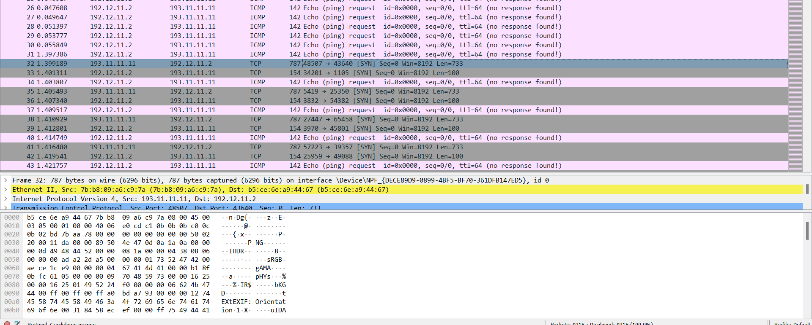
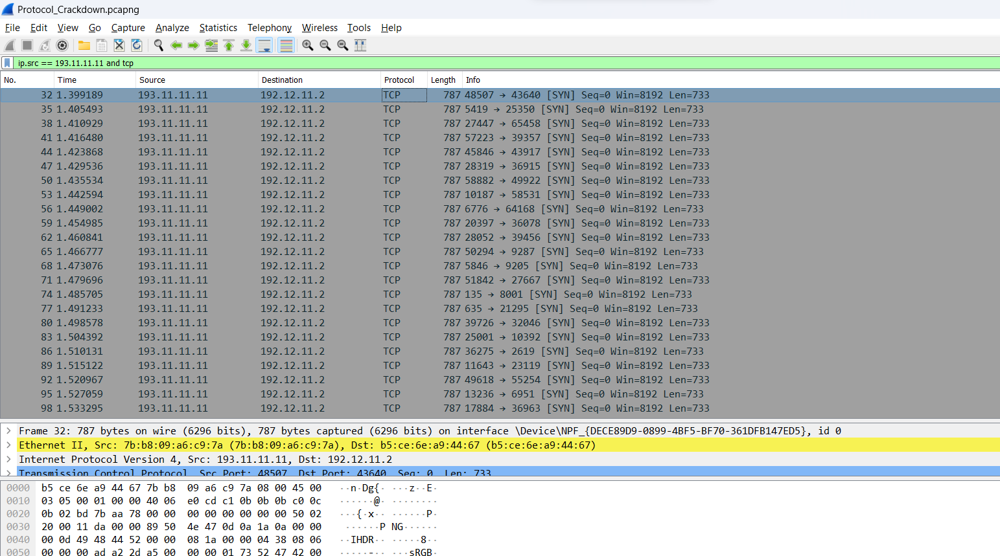
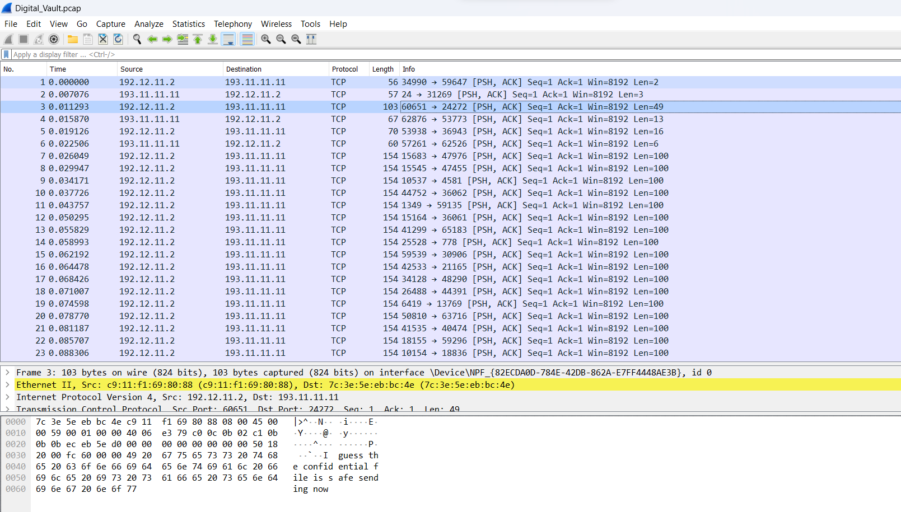
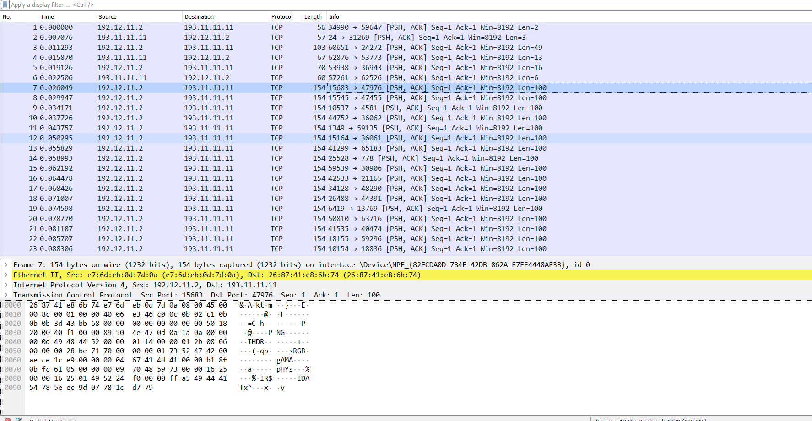
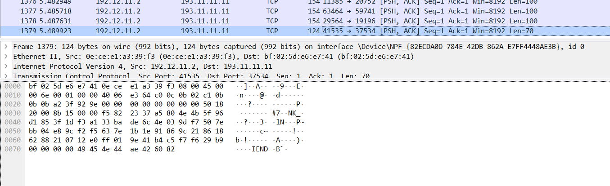
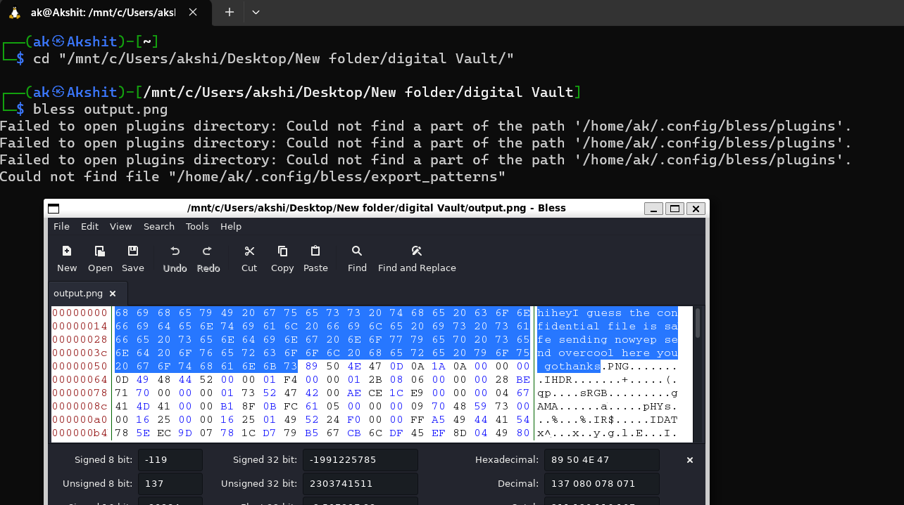
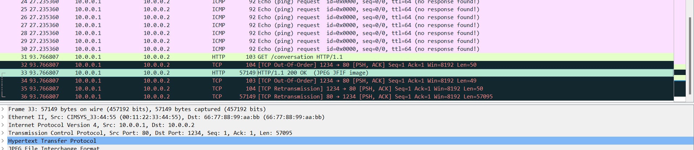
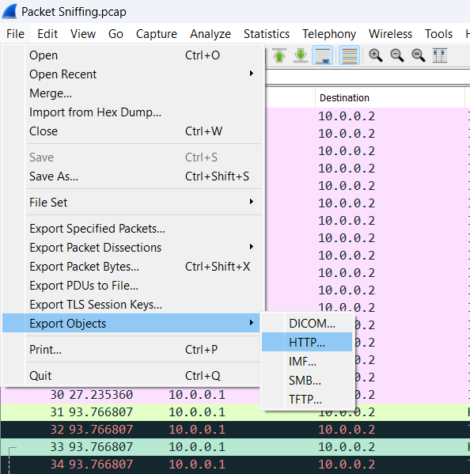
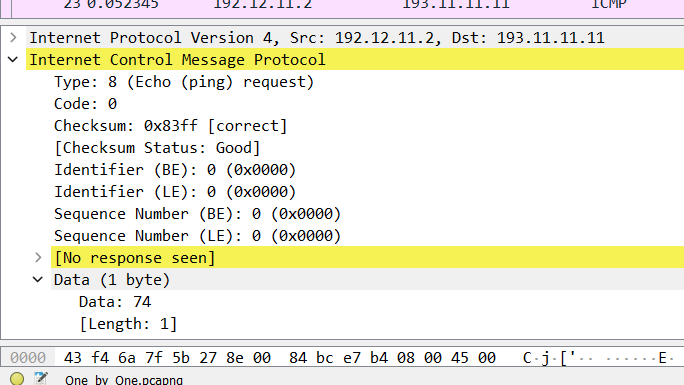

## Overview

When a file crosses a network, it doesn't travel as a file. The application hands a stream of bytes to the operating system, which cuts it into segments that fit the link, wraps each segment in TCP, IP, and Ethernet headers, and sends them one by one. A packet capture records those packets, not the file. Recovering the file means undoing the process: find the packets that carry it, put them in the right order, strip the headers, and join the payloads back together.

The same idea works in reverse for exfiltration. Someone who wants to sneak data out can spread it across packets that look harmless, such as one character per ICMP echo request. No single packet looks suspicious, but put the payloads together and you have the message.

This post is a reference guide to both cases. I cover how application data is carried across packets, then work through four network-forensics challenges from the **DD CTF** run by team [bi0s](https://bi0s.in/):

1. **Protocol Crackdown**: a PNG split across TCP packets mixed in with decoy traffic. The fix is to filter by sender, sort by sequence number, and join the payloads.
2. **Digital Vault**: a PNG sent after a short chat over TCP. The fix is to join everything and carve the image out by its signature.
3. **Packet Sniffing**: a JPEG served over HTTP, where Wireshark does the reassembly for you.
4. **One by one**: a message leaked one character per ICMP echo payload.

The tools are Wireshark for looking around, [Scapy](https://scapy.net/) for scripted extraction, and a hex editor to check the result.

> **Scope and ethics.** These were educational challenge captures from a CTF that has since concluded. All analysis was done on local copies of files the organisers distributed for that purpose. Flags are redacted as `bi0s{...}`.

## How application data is split across packets

### Encapsulation

Every packet in a capture is a set of nested layers. For the traffic in this post, a frame looks like this:

```text
┌──────────┬──────────┬───────────────┬─────────────────────────────┐
│ Ethernet │ IPv4     │ TCP or ICMP   │ payload (application bytes) │
│ 14 bytes │ 20 bytes │ 20+ / 8 bytes │ what you want to recover    │
└──────────┴──────────┴───────────────┴─────────────────────────────┘
```

Wireshark's packet details pane shows these layers as expandable rows, and the `Len=` value in the TCP summary line is the size of the payload alone. Reassembly means taking that last field from the right packets and ignoring everything else.

### TCP sequence numbers

TCP is a byte stream. Each segment carries a **sequence number**, which is the stream position of its first payload byte. If a segment with sequence number *N* carries *L* bytes, the next one in the stream starts at *N + L*. That is what makes reassembly possible: sort the segments by sequence number and their payloads line up end to end, even if they arrived out of order.

Two details matter in practice:

- **Wireshark shows relative sequence numbers by default.** The real 32-bit starting value is random, so Wireshark subtracts it and shows each conversation starting at 0 (or 1 after the handshake). Scapy's `p[TCP].seq` is the raw value, which Wireshark exposes as the field `tcp.seq_raw`.
- **Retransmissions and out-of-order segments are normal.** A lost segment gets sent again with the same sequence number, so naive concatenation would include those bytes twice. Wireshark flags these packets as `[TCP Retransmission]` and `[TCP Out-Of-Order]`.

### What counts as one stream

Wireshark groups TCP packets into conversations by their 4-tuple: source IP, source port, destination IP, and destination port. **Follow → TCP Stream** works on one conversation at a time. That fails when every packet uses a new port pair, as two of the challenges below do: each packet becomes its own one-packet "stream", so you have to do the grouping yourself.

### ICMP payloads

An ICMP echo request (`ping`, type 8) has an 8-byte header followed by a data field that the receiver echoes back. Normal tools fill it with something predictable: Windows `ping` sends 32 bytes of the alphabet, and Linux `ping` sends 56 bytes starting with a timestamp. The protocol doesn't care what goes there, which makes the data field a convenient place to hide bytes.

## The reassembly workflow

Every challenge below follows the same five steps:

1. **Identify** what is being transferred. Look for file signatures in the packet bytes pane.
2. **Isolate** the packets that carry it. Filter by protocol, source, destination, or port.
3. **Order** them. Use the TCP sequence number if it carries meaning, otherwise capture order.
4. **Extract and join** the payloads, and only the payloads.
5. **Verify** the result by checking its signature and opening it.

For the first step, these are the signatures that come up here:

| Format | Starts with | Ends with |
|---|---|---|
| PNG | `89 50 4E 47 0D 0A 1A 0A` (`.PNG....`) | `49 45 4E 44 AE 42 60 82` (`IEND` + its CRC) |
| JPEG | `FF D8 FF` | `FF D9` |

The PNG trailer is always the same because the IEND chunk never changes. I cover why in [Repairing Corrupted PNG Files by Hand](). Seeing `89 50 4E 47` at the start of a payload means a PNG transfer begins in that packet. Seeing `IEND AE 42 60 82` means it ends there.

## Scapy essentials

[Scapy](https://scapy.net/) reads both `.pcap` and `.pcapng` files and represents each packet as a stack of layers that you can index by type. These are the pieces I use throughout:

```python
from scapy.all import rdpcap, IP, TCP, ICMP, Raw

packets = rdpcap("capture.pcapng")    # list-like PacketList

for p in packets:
    if IP in p and TCP in p and Raw in p:   # layer membership tests
        src  = p[IP].src                    # "193.11.11.11"
        seq  = p[TCP].seq                   # raw 32-bit sequence number
        data = p[Raw].load                  # payload as bytes
```

**Use `p[Raw].load`, not `bytes(p[TCP].payload)`.** Ethernet frames have a 60-byte minimum, so a packet with a tiny payload gets zero-padded on the wire. Scapy parses those extra bytes as a separate `Padding` layer after the payload. `bytes(p[ICMP].payload)` includes the padding, but `p[Raw].load` is only the real data. On a test frame I built with a 1-byte ICMP payload, the difference looks like this:

```text
bytes(p[ICMP].payload) -> b'H\x00\x00\x00\x00\x00\x00\x00\x00\x00\x00\x00\x00\x00\x00\x00\x00\x00'
p[Raw].load            -> b'H'
```

Padding bytes that end up in the middle of a reassembled file corrupt it, so I always read from `Raw`.

## Challenge 1: Protocol Crackdown

### Spotting the transfer

`Protocol_Crackdown.pcapng` mixes three kinds of traffic: ICMP echo requests from `192.12.11.2` to `193.11.11.11` that never get a reply, 100-byte TCP packets in the same direction, and larger TCP packets coming back from `193.11.11.11`. The first of the larger packets, frame 32, gives the game away in its bytes:



The payload starts with `89 50 4E 47 0D 0A 1A 0A` followed by an `IHDR` chunk, so a PNG transfer starts here and `193.11.11.11` is the sender.

These packets aren't normal TCP. Every one is a **SYN** (connection request) carrying 733 bytes of data, and each uses a different port pair. A real client sends data only after the three-way handshake. Here, each packet is its own one-packet conversation, so Follow TCP Stream would only ever show one packet's worth of the file.

### Isolating the sender

I isolated the sender with a display filter:

```text
ip.src == 193.11.11.11 and tcp
```



All that's left is the sender's segments, every third frame, each 787 bytes on the wire. Every one shows `Seq=0` because each is a separate conversation and Wireshark shows relative sequence numbers. Scapy sorts on the raw values instead. I didn't record those, but the sort produced a valid image. So either the raw numbers encode the order, or they are identical and Python's stable sort leaves the packets in capture order. Either way the result is correct.

### Reassembling with Scapy

The script mirrors the filter. It keeps TCP packets from the sender that have a payload, sorts them by raw sequence number, and joins the payloads:

```python
from scapy.all import rdpcap, IP, TCP, Raw

SENDER = "193.11.11.11"

packets = rdpcap("Protocol_Crackdown.pcapng")

segments = [
    p for p in packets
    if IP in p and TCP in p and Raw in p and p[IP].src == SENDER
]
segments.sort(key=lambda p: p[TCP].seq)

data = b"".join(p[Raw].load for p in segments)

with open("output.png", "wb") as f:
    f.write(data)

print(f"{len(segments)} segments, {len(data)} bytes, starts with {data[:4].hex(' ')}")
```

Before opening the output, I check that it starts with the PNG signature:

```python
with open("output.png", "rb") as f:
    print(f.read(8).hex(" "))   # expect: 89 50 4e 47 0d 0a 1a 0a
```

`file output.png` or `xxd output.png | head -1` does the same job from the shell. If the first bytes are anything other than `89 50 4E 47`, either the filter caught an extra packet or the sort put the wrong segment first. The image opened cleanly:

.")

### The same thing with tshark

I did this challenge in Wireshark and Scapy. The command-line equivalent is a tshark pipeline that prints the raw sequence number and payload hex for each matching packet, sorts by sequence number, and converts the hex back to bytes:

```shell
tshark -r Protocol_Crackdown.pcapng -Y "ip.src == 193.11.11.11 && tcp" \
       -T fields -e tcp.seq_raw -e tcp.payload \
  | sort -n | cut -f2 | xxd -r -p > output.png
```

## Challenge 2: Digital Vault

### A conversation, then a file

`Digital_Vault.pcap` starts with six short TCP messages between `192.12.11.2` and `193.11.11.11`. Frame 3's payload reads "I guess the confidential file is safe sending now":



From frame 7 onward, `192.12.11.2` sends a run of 100-byte segments. Frame 7's payload starts with the PNG signature:



Frame 1379 carries the last 70 bytes, which end with the fixed IEND trailer:



As in Protocol Crackdown, every packet uses a new port pair. Here they all show `Seq=1 Ack=1`, so the sequence number carries no ordering information, and capture order is the only order there is. Filtering by source isn't enough either, because `192.12.11.2` also sent three of the chat messages.

### Concatenate, then carve

My first pass joined every TCP payload in capture order and wrote the result to a file. Opening it in Bless showed the chat glued to the front of the image:



The signature starts at offset `0x59` (89). That matches the six chat payloads exactly: 2 + 3 + 49 + 13 + 16 + 6 = 89 bytes, or "hi", "hey", the 49-byte announcement, "yep send over", "cool here you go", and "thanks". Deleting those 89 bytes in Bless gave a valid PNG.

Rather than trimming by hand, I now carve the file out by its known start and end markers. This is how file carvers recover files from any blob of bytes:

```python
from scapy.all import rdpcap, TCP, Raw

PNG_SIG = b"\x89PNG\r\n\x1a\n"
PNG_END = b"IEND\xaeB`\x82"

packets = rdpcap("Digital_Vault.pcap")
stream = b"".join(p[Raw].load for p in packets if TCP in p and Raw in p)

start = stream.find(PNG_SIG)
end = stream.find(PNG_END, start)
if start == -1 or end == -1:
    raise SystemExit("no complete PNG in the reassembled stream")
end += len(PNG_END)

print(f"PNG found at offset {start}, {end - start} bytes")
with open("output.png", "wb") as f:
    f.write(stream[start:end])
```

``b"IEND\xaeB`\x82"`` is just `49 45 4E 44 AE 42 60 82` written as a Python bytes literal (`0x42` is `B` and `0x60` is a backtick). Carving works here because no other traffic is mixed into the transfer. If other data were interleaved with the image, I would have to filter first, as in Protocol Crackdown.

.")

## Challenge 3: Packet Sniffing

Sometimes the protocol already describes the file, and the tool can rebuild it for you. `Packet Sniffing.pcap` has some ICMP noise between `10.0.0.1` and `10.0.0.2`, then an HTTP request for `/conversation` and a `200 OK` response that Wireshark identifies as a JPEG:



Notice the `[TCP Out-Of-Order]` and `[TCP Retransmission]` frames around the response. These are exactly what a naive "join all payloads" script would get wrong, since a retransmitted copy of the response would be included twice. Wireshark's HTTP dissector works on the reassembled TCP stream, which takes care of them. Since the response declares its own content and length, **File → Export Objects → HTTP** can save the body directly:



If the saved object has no image extension, rename it to `.jpeg`. Its first bytes, `FF D8 FF`, identify it either way.

.")

From the command line, tshark can export the same objects in one step:

```shell
tshark -r "Packet Sniffing.pcap" --export-objects http,exported/
```

Export Objects also supports DICOM, IMF (email), SMB, and TFTP. When the data travels over one of those protocols, try it before writing any code.

## Challenge 4: One by one, an ICMP covert channel

### The channel

The challenge description says the server sends messages where "each packet contains only one character in its payload". Opening `One_by_One.pcapng` confirms it. Each ICMP echo request from `192.12.11.2` to `193.11.11.11` carries a one-byte data field:



The byte shown is `0x74`, which is ASCII `t`. A few other details point to a covert channel rather than real pings:

- **The payload size is wrong.** Real ping tools send 32 or 56 bytes of filler, not a single byte.
- **No replies.** Wireshark marks the request `[No response seen]`. The sender cares about getting bytes onto the wire, not about whether the host is up.
- **The ICMP identifier and sequence number are both 0.** Real ping increments the sequence number with each request. Here it carries no ordering information, so capture order is the order of the message.

### Extracting it with Scapy

Each echo request contributes one character, so the script reads the first byte of each payload and joins them in capture order:

```python
from scapy.all import rdpcap, ICMP, Raw

packets = rdpcap("One_by_One.pcapng")

message = "".join(
    chr(p[Raw].load[0])
    for p in packets
    if ICMP in p and Raw in p and p[ICMP].type == 8
)
print(message)
```

The `type == 8` check limits extraction to echo requests. In this capture it makes no difference, but on a channel where the receiver does reply, each echo reply (type 0) carries the same data back, and every character would come out twice.

Running it prints a short message with the flag embedded in it:

.")

The tshark equivalent prints each request's data field as hex and converts the hex back to text:

```shell
tshark -r One_by_One.pcapng -Y "icmp.type == 8" -T fields -e data.data | xxd -r -p
```

### Spotting this on a real network

These same signs give a defender something to look for:

- Echo requests with unusual data lengths. A filter such as `icmp.type == 8 && data.len < 16` brings up the tiny ones.
- Lots of echo requests to one host with no replies.
- Payloads that decode to printable text, or whose bytes change from packet to packet when real ping filler is constant or timestamp-based.

Real exfiltration tools usually pack more than one byte into each packet, and may encrypt it, but the size and timing anomalies remain.

## Reassembling a real TCP stream

Both TCP challenges were simplified on purpose: one sender, no retransmissions, and either useful sequence numbers or a clean capture order. Real traffic is messier. A slightly more robust version of the script keys segments by sequence number, so a retransmitted copy of a segment is kept only once:

```python
from scapy.all import rdpcap, IP, TCP, Raw

def reassemble(packets, src):
    segments = {}
    for p in packets:
        if IP in p and TCP in p and Raw in p and p[IP].src == src:
            segments.setdefault(p[TCP].seq, p[Raw].load)
    return b"".join(segments[seq] for seq in sorted(segments))
```

This still assumes one stream, no sequence-number wraparound, and no partially overlapping segments. For a real conversation, I let Wireshark do the work: **Follow → TCP Stream**, set "Show data as" to **Raw**, choose a single direction, and **Save as**. tshark does the same from the command line, where the last argument is the stream index:

```shell
tshark -r capture.pcap -q -z follow,tcp,raw,0
```

Scripted reassembly is for the cases Wireshark can't group, like the per-packet port pairs and SYN-carried data above.

## Takeaways

- **A capture holds packets, not files.** To recover a file you identify it, isolate its packets, order them, extract only the payloads, and verify the result. Each challenge here is a variation on those five steps.
- **Signatures tell you where to start and stop.** `89 50 4E 47 0D 0A 1A 0A` marks the start of a PNG and `IEND AE 42 60 82` marks its end. Search the bytes pane for them to find the transfer, and use them to carve the file out of a noisy stream.
- **Know what your ordering key actually encodes.** TCP sequence numbers order a real stream, but Wireshark shows relative values, and crafted traffic can make them meaningless (`Seq=1` everywhere in Digital Vault). If they carry no order, capture order is all you have.
- **Extract payloads, not layers.** In Scapy, `p[Raw].load` gives the real data. `bytes(layer.payload)` can include Ethernet padding.
- **Any field the protocol ignores can carry data.** An ICMP echo payload is arbitrary bytes. One byte per packet is slow but hard to notice by eye, and unusual sizes plus missing replies are the giveaway.

*Tools: Wireshark, Scapy, Bless hex editor, Eye of GNOME. Challenges: "Protocol Crackdown", "Digital Vault", "Packet Sniffing", and "One by one", DD CTF by team bi0s.*
