## Overview

"Fix the broken image" is one of the most common forensics challenges in CTFs, and it is also a real-world skill: truncated downloads, bad disk sectors, and careless tooling all leave behind PNG files that image viewers refuse to open. The good news is that PNG is a very regular format. Every file is an 8-byte signature followed by a sequence of self-describing **chunks**, and every chunk carries its own checksum. That means the file tells you exactly where it is broken. You just need to know how to read it.

This post is a reference guide to that process. I cover the parts of the PNG format that matter for repair, then work through two challenges from the **DD CTF** run by team [bi0s](https://bi0s.in/):

1. **fixme**: a corrupted signature, a corrupted IHDR chunk name, and an IDAT chunk renamed to `Iadt`.
2. **upgraded fixme**: the same header damage, plus deliberately wrong CRC checksums on the IHDR and IDAT chunks.

The toolkit is small: an image viewer to confirm the failure (`eog`), [`pngcheck`](http://www.libpng.org/pub/png/apps/pngcheck.html) to diagnose it, `pngcrush` as a second opinion, and the [Bless](https://github.com/afrantzis/bless) hex editor to patch bytes.

> **Scope and ethics.** These were educational challenge files from a CTF that has since concluded. Everything here was done on local copies of files the organisers distributed for that purpose. Flags are redacted as `bi0s{...}`.

## The PNG format in five minutes

The authoritative reference is the [PNG chunk specification](https://www.w3.org/TR/PNG-Chunks.html). For repair work you need three ideas: the signature, the chunk layout, and the critical chunks.

### The 8-byte signature

Every PNG starts with the same eight bytes:

```text
89 50 4E 47 0D 0A 1A 0A
   P  N  G  \r \n ^Z \n
```

Each byte has a job. `0x89` is a non-ASCII byte that catches transfers that strip the high bit. `PNG` identifies the format. The `\r\n` / `\n` pair catches line-ending conversion. `0x1A` (Ctrl-Z) stops a DOS `type` command from printing binary garbage. If any byte is wrong, decoders reject the file immediately with something like "Not a PNG file", and they never look further.

### Chunk layout

After the signature, the file is a series of chunks, each with the same four fields:

| Field | Size | Contents |
|---|---|---|
| Length | 4 bytes, big-endian | Number of bytes in the data field only |
| Type | 4 bytes | ASCII chunk name, e.g. `IHDR`, `IDAT` |
| Data | *Length* bytes | Chunk payload |
| CRC | 4 bytes, big-endian | CRC-32 over **Type + Data** (not Length) |

That last row is the important one for repair: **the CRC covers the chunk type as well as the data**. Corrupting a single letter of a chunk name therefore also breaks that chunk's checksum, even though no data byte changed.

### Critical chunks

Three chunk types are *critical*, meaning a decoder must understand them to display the image:

- **IHDR**: always first. Its 13 data bytes hold width (4), height (4), bit depth (1), colour type (1), compression method (1), filter method (1), and interlace method (1).
- **IDAT**: the compressed image data. It can be split across several consecutive IDAT chunks.
- **IEND**: always last, with zero-length data. Because its type and data never vary, an intact IEND chunk is always the same 12 bytes: `00 00 00 00 49 45 4E 44 AE 42 60 82`.

(`PLTE` is also critical for palette-based images, but neither challenge here uses it.) Everything else, such as `gAMA`, `cHRM`, `pHYs`, `tEXt`, or `tIME`, is *ancillary*: a decoder can skip it.

### Chunk names encode properties

The case of each letter in a chunk name is a flag (bit 5 of each byte). An **uppercase first letter means critical** and a lowercase one means ancillary. The second letter marks public or private, the third is reserved and must be uppercase, and a **lowercase fourth letter means "safe to copy"**. This is why tools can describe a chunk they have never seen before, and it explains the error messages below.

## Challenge 1: fixme

### Confirming the damage

First I simply tried opening the file. Eye of GNOME refused outright:

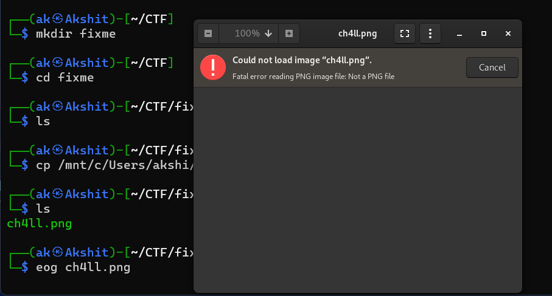

"Not a PNG file" is the signature check failing. The decoder bailed out at the first eight bytes, so that is where to look first.

### Reading the header in a hex editor

I opened `ch4ll.png` in Bless and put it next to a reference diagram of a correct PNG header:

 against the reference layout (top): the signature and the IHDR name are both wrong.")

Comparing the two byte by byte shows two problems:

- **Signature**: the file starts `67 54 78 47` (`gTxG`) instead of `89 50 4E 47` (`.PNG`). The trailing `0D 0A 1A 0A` is intact.
- **IHDR name**: the length field `00 00 00 0D` (13) is correct, but the type reads `49 68 72 64` (`Ihrd`) instead of `49 48 44 52` (`IHDR`).

The IHDR data itself looks sane: width `00 00 03 E8` (1000), height `00 00 02 58` (600), bit depth 8, colour type 6 (RGBA), and zeros for compression, filter, and interlace. The stored CRC is `F1 1E CC 25`. When I calculate a CRC-32 over `IHDR` plus those 13 bytes, I get exactly `f11ecc25`, so the checksum was never touched. Only the name was corrupted, and restoring the name will make the CRC valid again.

The rest of the visible header (`gAMA`, `cHRM`, `pHYs`, `bKGD`, `tIME`, and a `tEXt` comment from `gd-jpeg`) is ordinary ancillary metadata.

### Fixing the signature and IHDR

I overwrote the first 16 bytes with the correct values:

```text
89 50 4E 47 0D 0A 1A 0A   00 00 00 0D   49 48 44 52
└──── signature ──────┘   └─ length ─┘   └── IHDR ──┘
```

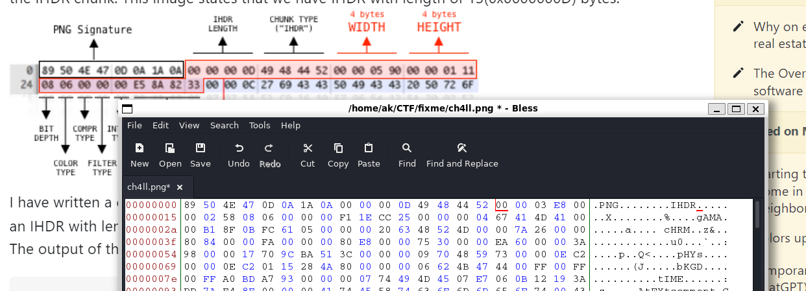

### The Iadt chunk

With a valid signature, `pngcheck` could now parse the file, and it found the next problem:

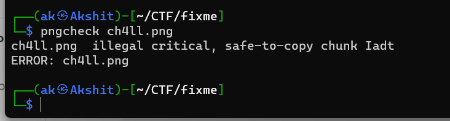

This is the chunk-naming rule at work. `Iadt` starts with an uppercase `I`, so it claims to be **critical**, and it ends with a lowercase `t`, so it claims to be **safe to copy**. Its third letter is also lowercase, which breaks the reserved-bit rule. No such chunk exists in the spec, and a decoder cannot skip an unknown critical chunk, so the file is unreadable. The obvious suspect is `IDAT`: same letters, wrong case.

Before editing, I wanted to rule out damage at the end of the file too, so I searched for the fixed IEND CRC `AE 42 60 82`:

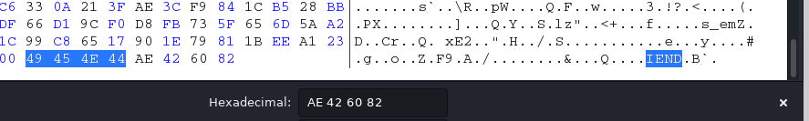

Opening the file again gave a more specific error. The viewer now got past the header and failed on the renamed chunk:

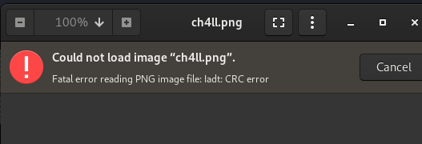

The "CRC error" here is a symptom, not a separate bug. The stored CRC was calculated over `IDAT` plus the data. Because the CRC covers the chunk type, renaming the chunk to `Iadt` makes the checksum mismatch even though the data is intact.

For a second opinion I ran `pngcrush -fix`, which spells out the offending bytes:

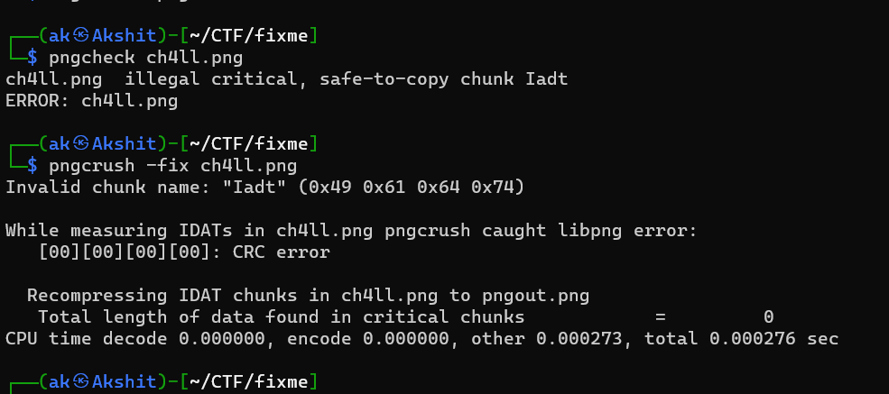

pngcrush could not produce output either. It found zero bytes of data in critical chunks because it never recognised the image data. But it did give me the exact bytes to search for: `49 61 64 74`.

### Renaming Iadt to IDAT

Searching Bless for `Iadt` lands on the chunk right after the `tEXt` timestamp metadata:

 sitting where IDAT should be.")

I replaced those four bytes with the real IDAT type, `49 44 41 54`, and left the length, data, and CRC alone. pngcheck then passed the whole file:

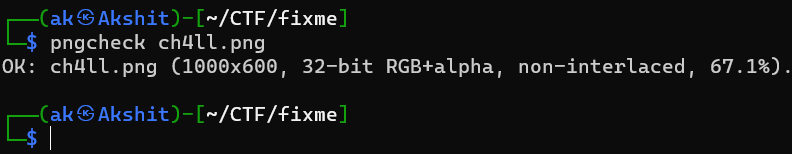

There was no CRC complaint, which confirms the reasoning above: the original checksum was correct for `IDAT`, and only the name had been changed. The reported 1000x600 RGBA also matches the IHDR values I decoded by hand.

.")

## Challenge 2: upgraded fixme

The second challenge starts with the same kind of header damage, then adds the real twist: wrong checksums.

### Same diagnosis, same fix

pngcheck rejected the file before parsing a single chunk:

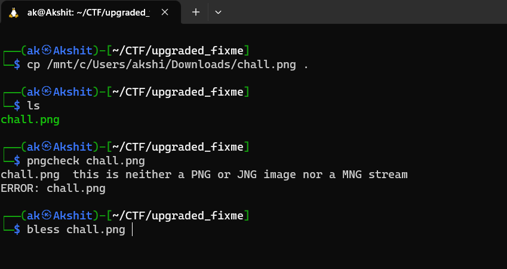

In Bless, the header shows the same two kinds of corruption as before:

 and the IHDR type reads Iddd (49 64 64 64).")

- **Signature**: `89 70 67 6E` (`.pgn`) instead of `89 50 4E 47` (`.PNG`).
- **IHDR name**: `49 64 64 64` (`Iddd`) instead of `49 48 44 52` (`IHDR`).

I applied the same 16-byte fix as in the first challenge:

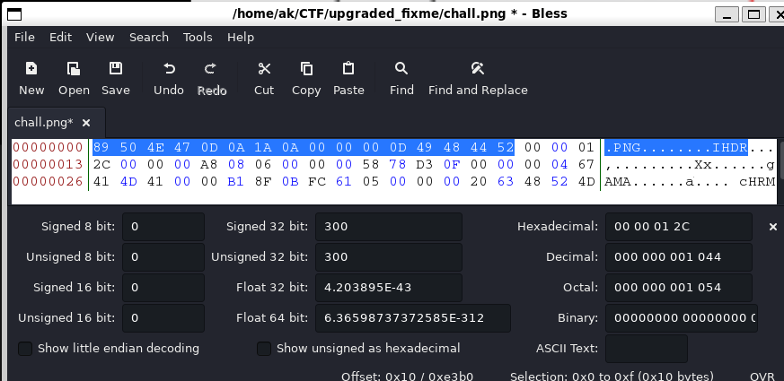

The IHDR data that follows is width `00 00 01 2C` (300), height `00 00 00 A8` (168), bit depth 8, colour type 6, then zeros. The stored CRC is `58 78 D3 0F`.

### CRC errors: which value is right?

With the header fixed, pngcheck moved on and reported a checksum failure:

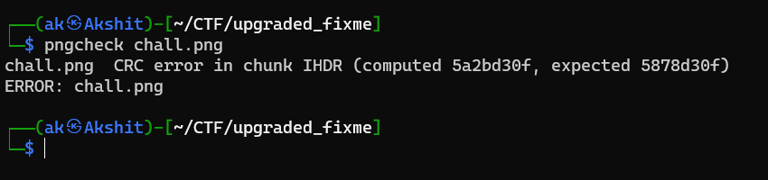

This is the step I initially got backwards, so it is worth stating precisely. In pngcheck's message:

- **`expected`** is the CRC **currently stored in the file** (`58 78 D3 0F`). It is what the file claims the checksum should be.
- **`computed`** is the CRC pngcheck **calculated from the bytes actually present** (`5a2bd30f`).

The data is intact, so the computed value is the correct one and the stored "expected" value is the corruption. The fix is to **search the file for the expected value and overwrite it with the computed one**. The word "expected" makes it sound authoritative, but in this message it means "what the file says", not "what it should be".

I also verified this independently. A CRC-32 over `IHDR` + `00 00 01 2C 00 00 00 A8 08 06 00 00 00` gives `5a2bd30f`, which matches pngcheck's computed value.

In Bless I searched for the stored value `58 78 D3 0F`:

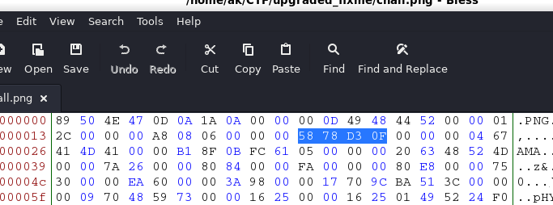

I replaced it with the computed CRC `5A 2B D3 0F`:

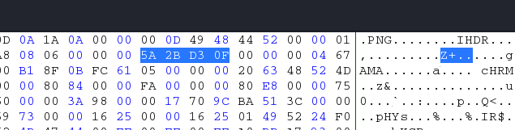

> **When *not* to just overwrite the CRC.** Replacing the CRC is the right repair only when the chunk data is trustworthy. A common variant of this challenge does the opposite: it tampers with the IHDR *height* and leaves the original CRC in place, which hides the bottom of the image. In that case, overwriting the CRC silences the checker but leaves the image cropped. The correct approach is to brute-force the width or height until the CRC matches the stored value. Here, I checked every width and height from 1 to 5000 against the stored `5878d30f` and none matched, so the CRC really was the tampered field.

### A second CRC error in IDAT

pngcheck then got further and found the same trick on the image data:

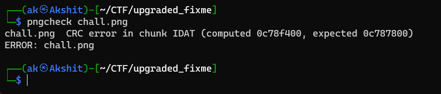

Same strategy: search for the expected (stored) value `0C 78 78 00`:

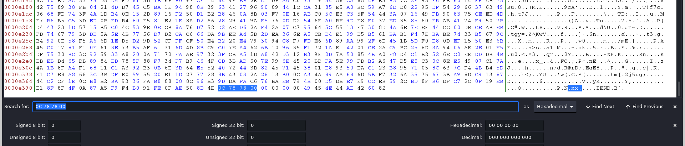

The match sits right before `00 00 00 00 49 45 4E 44 AE 42 60 82`, the fixed IEND chunk. That placement makes sense: the CRC of the last IDAT chunk is the final field before IEND. I overwrote it with the computed value `0C 78 F4 00`, and pngcheck reported the file as OK (300x168, 32-bit RGB+alpha):

.")

## A quick chunk walker

pngcheck stops at the first error, which is why both challenges needed several check-fix-recheck rounds. When I want every problem at once, I use a short Python script that walks the chunks and compares the stored and computed CRC for each one:

```python
import struct, sys, zlib

PNG_SIG = b"\x89PNG\r\n\x1a\n"

def walk(path):
    data = open(path, "rb").read()
    print("signature ok" if data[:8] == PNG_SIG else f"bad signature: {data[:8].hex(' ')}")
    pos = 8
    while pos + 8 <= len(data):
        length, ctype = struct.unpack(">I4s", data[pos:pos + 8])
        body = data[pos + 8:pos + 8 + length]
        stored = struct.unpack(">I", data[pos + 8 + length:pos + 12 + length])[0]
        computed = zlib.crc32(ctype + body)
        status = "ok" if stored == computed else f"CRC MISMATCH (stored {stored:08x}, computed {computed:08x})"
        print(f"0x{pos:06x}  {ctype.decode('latin-1'):4}  len={length:<8} {status}")
        pos += 12 + length
        if ctype == b"IEND":
            break

walk(sys.argv[1])
```

On a test PNG where I reproduced the fixme damage (bad signature, IDAT renamed to `Iadt`), it reports both problems in one pass. It also shows the rename-breaks-the-CRC effect directly:

```text
bad signature: 67 54 78 47 0d 0a 1a 0a
0x000008  IHDR  len=13       ok
...
0x000053  Iadt  len=16286    CRC MISMATCH (stored fc505961, computed a036421c)
0x003ffd  IEND  len=0        ok
```

The script assumes the length fields are intact. If a length is corrupted, the walk goes off the rails at that chunk, and the offset where it does is itself a clue.

## Takeaways

- **Fix from the front.** Decoders fail at the first problem, so work in file order: signature, then IHDR, then the chunks that follow. Re-run `pngcheck` after every edit, because each fix exposes the next error.
- **Know the constants.** The signature `89 50 4E 47 0D 0A 1A 0A`, the IHDR length `00 00 00 0D` and type `49 48 44 52`, and the IEND chunk `00 00 00 00 49 45 4E 44 AE 42 60 82` never change. They are the fastest way to orient yourself in a hex dump.
- **Chunk-name case is meaningful.** A misspelled name like `Iadt` is not just a typo. Its case bits make decoders treat it as an unknown critical chunk, and since the CRC covers the type, it also produces a CRC error.
- **In pngcheck, "computed" is the truth and "expected" is what the file claims.** When the data is intact, replace the stored (expected) CRC with the computed one. When the data might be tampered, such as IHDR dimensions, brute-force the data to match the stored CRC instead.

*Tools: Eye of GNOME, Bless hex editor, pngcheck, pngcrush, Python `zlib`. Challenges: "fixme" and "upgraded fixme", DD CTF by team bi0s.*
