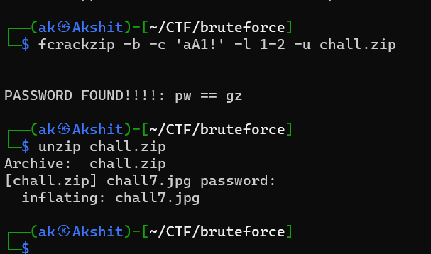
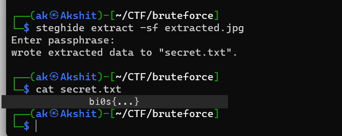
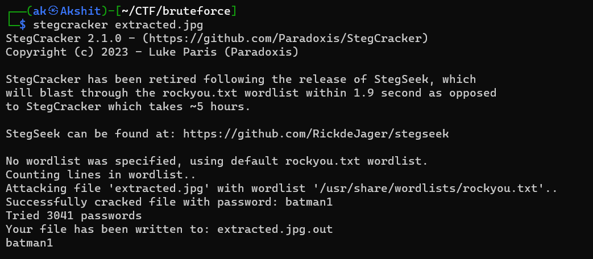
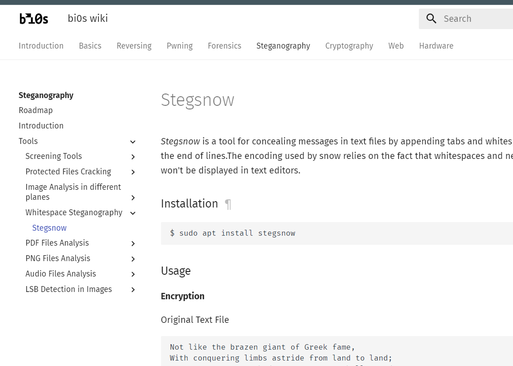
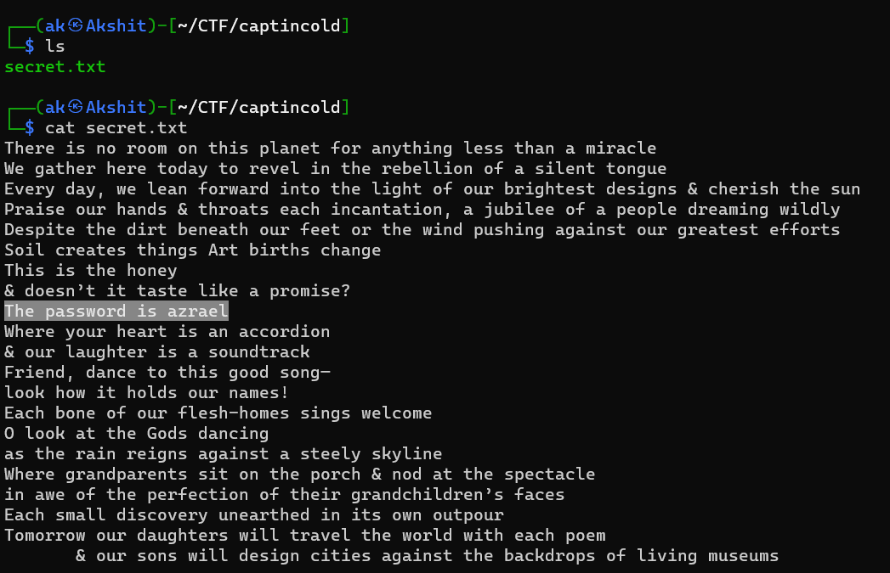
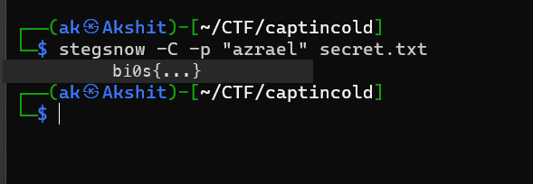

## Overview

Cryptography hides the *contents* of a message; steganography hides its *existence*. A steganographic payload rides inside a carrier that looks completely ordinary, a holiday photo or a short poem, so that nothing about the file invites a second look. That makes it a recurring theme in forensics CTFs and a genuine concern in the wild, where it shows up in malware droppers and data-exfiltration channels.

This post is a reference to the standard stego workflow. I cover the main places data gets hidden, the tools that find it, and then work through two challenges from the **DD CTF** run by team [bi0s](https://bi0s.in/):

1. **bruteforce**: a JPG whose embedded data is locked behind a steghide passphrase.
2. **captian cold**: a text document with a message hidden entirely in its whitespace.

The single best reference for this material is the [bi0s steganography wiki](https://wiki.bi0s.in/steganography/), which the challenges themselves point you toward and which I lean on throughout.

> **Scope and ethics.** These were educational challenge files from a CTF that has since concluded, worked on local copies of files the organisers distributed for that purpose. Steganography tooling is dual-use; only analyse files you own or have explicit permission to examine. Flags are redacted as `bi0s{...}`, including inside screenshots.

## Where data hides, and how you find it

Before any extraction, it helps to know the categories of hiding place, because each one has its own detection tool. For image carriers there are three common techniques:

- **Metadata.** The simplest hiding spot is a comment or EXIF field. `exiftool image.jpg` dumps every tag, and a payload stuffed into an author, comment, or GPS field is immediately visible.
- **Appended data.** A file can carry a second file bolted onto its end, past the point where an image viewer stops reading. `binwalk image.jpg` scans for embedded file signatures, and `strings image.jpg` surfaces any readable text riding along. An appended ZIP or archive is the classic case here.
- **Embedded / LSB data.** Tools like `steghide` weave a payload into the carrier's actual pixel or coefficient data, typically in the least significant bits, usually behind a passphrase. This is invisible to `strings` and needs a dedicated extraction tool.

For **text** carriers the game is different. There are no pixels to tamper with, so the data hides in characters you can't see: trailing spaces and tabs at the ends of lines. That is **whitespace steganography**, and it needs its own detector, `stegsnow`.

A fast way to triage an image without running each tool by hand is [aperisolve](https://www.aperisolve.com/), a web front-end that runs several analyses at once (`exiftool`, `binwalk`, `strings`, `zsteg`, bit-plane views, and more) and summarises the results on one page. It is my usual first stop for an unknown image.

The rest of this post follows the natural decision tree: inspect first, then extract with a known passphrase, brute-force the passphrase when it's unknown, and handle whitespace stego as its own path.

## Challenge 1: bruteforce (image stego with a passphrase)

### Getting to the carrier

The challenge ships as a ZIP, and the ZIP itself is password-protected. A short brute-force with `fcrackzip` over a small alphanumeric keyspace recovers the archive password, and unzipping it yields the JPG carrier:



```bash
fcrackzip -b -c 'aA1!' -l 1-2 -u chall.zip
unzip chall.zip
```

### Inspecting with aperisolve

With the JPG in hand, I ran it through aperisolve rather than invoking each tool separately. The information panel is the useful part here: alongside the file size and upload history, aperisolve lists a set of **common passwords** it recognises as associated with the image, and `batman1` is right there in that list.

'.")

That is a lucky shortcut. `batman1` is a top entry in the `rockyou` leaked-password list, which is exactly why aperisolve flags it, and exactly why it would also fall to a brute-force in seconds. Having the passphrase already, I went straight to extraction.

### Extracting with steghide

`steghide extract` pulls the embedded payload out of the carrier. The `-sf` (stego file) flag names the carrier, and `-p` supplies the passphrase:

```bash
steghide extract -sf extracted.jpg -p batman1
```

steghide writes the recovered payload to `secret.txt`, and reading that file gives the flag:



### When the passphrase is unknown: stegcracker + rockyou.txt

The shortcut above only works because aperisolve handed me the password. The general case is that you don't have it, and then you brute-force the passphrase against a wordlist. `stegcracker` wraps steghide for exactly this, and `rockyou.txt` is the standard wordlist (it ships at `/usr/share/wordlists/rockyou.txt` on Kali). The usage the bi0s wiki documents is:

```bash
stegcracker extracted.jpg /usr/share/wordlists/rockyou.txt
```

Run with no wordlist argument, `stegcracker` falls back to `rockyou.txt` automatically. On this carrier it tries a few thousand candidates and lands on `batman1`, confirming the password aperisolve suggested and writing the decoded payload to `extracted.jpg.out`:



One practical note from that screenshot: `stegcracker` prints a banner saying it has been retired in favour of [stegseek](https://github.com/RickdeJager/stegseek), which blasts through the same wordlist in under two seconds instead of taking hours. If you're doing this today, reach for `stegseek extracted.jpg rockyou.txt` first; the mechanics and the result are identical.

## Challenge 2: captian cold (whitespace stego)

### Reading the hint

The challenge description is a wall of flavour text about investigators who find nothing with "conventional steganographic analysis" until one of them notices "a peculiar pattern in the document's seemingly innocuous **whitespace**." That is the whole hint: this is not image stego, it is **whitespace stego** in a text file, and the usual image tools will come up empty.

### Finding the tool on the bi0s wiki

Whitespace steganography has a dedicated tool, and the bi0s wiki's steganography section is where I confirmed it. Its "Whitespace Steganography" page covers **stegsnow**, which hides messages by appending tabs and spaces to the ends of lines, relying on the fact that trailing whitespace is invisible in an ordinary text editor:



### The carrier, and the password inside it

The carrier is `secret.txt`, which reads as an unremarkable poem. The content matters less than two things: there is clearly trailing whitespace carrying a hidden payload, and the cover text itself quietly states the passphrase needed to decode it ("The password is …", highlighted below):



### Decoding with stegsnow

`stegsnow -C` extracts (uncompresses) a concealed message from a text file. Where the payload is protected, `-p` supplies the password, which here is the one the poem spelled out:

```bash
stegsnow -C -p "azrael" secret.txt
```

That prints the flag directly:



If you only need to confirm that whitespace stego is present before worrying about a password, `stegsnow -C secret.txt` on an unprotected file is enough to dump the hidden text.

## Takeaways

- **Inspect before you extract.** Metadata, appended files, and embedded data each have their own detector (`exiftool`, `binwalk` / `strings`, `steghide`). Running them, or a one-shot front-end like aperisolve, tells you which technique you're actually dealing with before you waste time on the wrong one.
- **A passphrase you don't know is just a wordlist away.** When `steghide` wants a passphrase, `stegcracker` (or the far faster `stegseek`) against `rockyou.txt` recovers weak ones quickly. `batman1` falling in a few thousand tries is a reminder that these passwords are weak by design, and weak in the real world too.
- **Whitespace is a carrier.** When image tooling finds nothing and the hint points at spacing, switch to `stegsnow`. Trailing tabs and spaces are invisible in an editor but carry a full message, and `stegsnow -C` reads it straight back out.
- **The challenge often hands you the key.** Across both of these, the hard part wasn't the extraction command but noticing the clue: a common password aperisolve already knew, and a passphrase written into the cover text itself.

*Tools: fcrackzip, aperisolve, steghide, stegcracker (and stegseek), stegsnow. Reference: the [bi0s steganography wiki](https://wiki.bi0s.in/steganography/). Challenges: "bruteforce" and "captian cold", DD CTF by team bi0s.*
